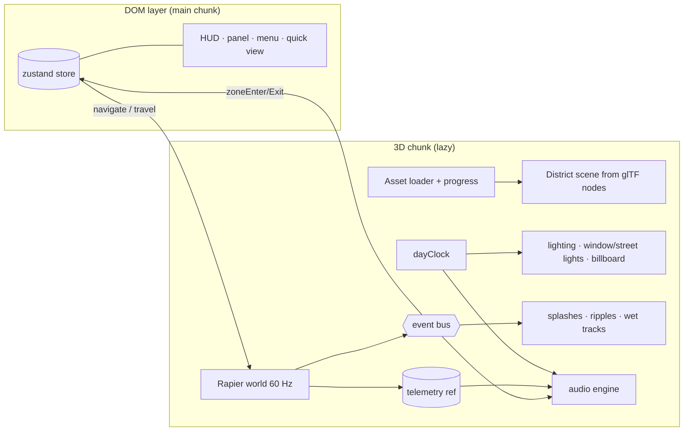
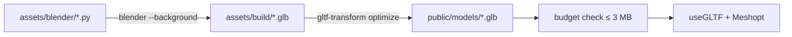

# Career District Vertical Slice - Plan

## Goal Capsule

- **Objective:** A visitor opens Apu Islam's portfolio, drives a weighty, good-looking car through one handcrafted district at golden hour, smashes a few props and splashes through a pond, hears a world that reacts to them, and reads the MetLife Software Engineer – AI experience at an original corporate tower — while the other portfolio sections stay one stop away. The slice proves the art direction and every system before the full city is built.
- **Means:** Rapier physics car (KTD1), Blender-scripted glTF assets (KTD4), Howler + Web Audio soundscape (KTD3), reusing the v0.2 UI, routing, and quick view (KTD10).
- **Product authority:** This Product Contract (2026-10-18 brainstorm, M1 of the roadmap below). It supersedes the v0.2 car, city geometry, and Career Tower in `docs/plans/2026-10-18-0302-feat-driving-city-portfolio-plan.md`; that plan's UI, routing, quick view, and access decisions stay in force.
- **Open blockers:** Blender must be installed on the developer Mac before U2–U4 can run (see Dependencies). Code units U1, U5–U11 can proceed meanwhile on stand-in primitives.
- **Stop conditions:** Stop and ask if a performance target in Success Criteria cannot be met without cutting a requirement, or if any audio/model source's license is not clearly CC0 or public domain.

---

## Product Contract

### Summary

Build one polished "golden-hour miniature metropolis" district: an original contemporary Career Tower, a physics-driven car with suspension, props and a brick wall that react to impacts, a shallow pond with splashes and wet tires, a reactive soundscape, a flickering "APU ISLAM" bulb billboard at the start, and a day cycle that runs from the visitor's local time through sunset, blue hour, and night. A city gate of four signpost kiosks opens the Research, Projects, Education, and Contact panels until those landmarks arrive in M2.

### Problem Frame

v0.2 proved the structure — drive, press E, read, switch to the quick view — but it reads as a functional prototype: boxy geometry, a car without weight, a silent world. Apu wants a portfolio that feels like a polished indie driving game, memorable to research and industry visitors, while still putting career details seconds away. Building a whole city in an unproven look risks expensive rework, so the first milestone proves the look and every system in one district. The driving-portfolio concept is inspired by bruno-simon.com; nothing of that site's code, layout, models, branding, or artwork may be reused.

### Key Decisions

- **M1 is a vertical slice of one district.** (session-settled: user-directed — chosen over "full city without audio/water" and "everything at once": proves look and systems before scaling.) Governs R1, R30.
- **Assets are Blender-scripted.** Python scripts generate every model as an optimized glTF committed to the repo. (session-settled: user-directed — chosen over procedural-in-code and hybrid CC0 models: softest handcrafted look, reproducible.) Governs R5.
- **Audio is CC0 samples plus a synthesized engine.** (session-settled: user-directed — chosen over all-synthesized and user-supplied sounds.) Governs R17, R18, R23.
- **The day cycle starts at the visitor's local time and runs a full day in about 12 minutes, with a HUD dial to pause or scrub.** (session-settled: user-directed — chosen over local-clock-only, which replaced v0.2's behavior, and a fixed loop.) Governs R24, R25.
- **Signpost kiosks stand in for the four other landmarks.** (session-settled: user-directed — chosen over quick-view-only and keeping the v0.2 towers: nothing reachable today disappears, one art style.) Governs R29.
- **The Career Tower is original, named "Career Tower", with MetLife named only in panel text.** (session-settled: user-approved — proposed in the synthesis and confirmed: no logo, colors, or building likeness.) Governs R4, R27.
- **A flickering "APU ISLAM" bulb billboard greets visitors at the start.** (session-settled: user-directed — requested at plan time.) Governs R6.
- **Carried from v0.2:** 3D first with the quick view always one click away and the place kept; WebGL/reduced-motion fallback to the quick view with a note; E in a glowing zone opens a panel and Esc closes it; fast-travel menu and click-to-travel; touch joystick; only real content is the role title, employer, and dates. (session-settled: user-directed — chosen in the v0.1/v0.2 brainstorms over a choice screen, drive-only access, and tap-to-travel only.) Governs R27, R28, R31, R32, R34, R35.

### Requirements

**World and look**

- R1. The 3D view is one district: a plaza spawn point, a short scenic road loop with an intersection, the Career Tower block, a landscaped park with the pond, a prop playground, and the city gate. No space elements remain.
- R2. The art direction is cartoon-realistic "golden-hour miniature metropolis": stylized proportions, bevelled soft edges, warm limestone, brass, and teal glass; not childish, low-poly, photorealistic, or neon-heavy.
- R3. Streets are landscaped: lane markings, sidewalks with curbs, trees, grass, streetlights, signs, benches, planters, and small decorative objects.
- R4. The Career Tower is an original contemporary corporate skyscraper: tapered glass curtain wall with vertical fins, stacked terraced balconies with planters, a sky-garden crown, and lit windows at night. It carries no corporate logo or branded likeness.
- R5. Every model (car, tower, props, furniture, billboard, kiosks, district pieces) comes from version-controlled Blender scripts and ships as an optimized glTF; no paid or copied assets.
- R6. An "APU ISLAM" bulb-marquee billboard stands where the opening camera reveal ends on it. On load its letters flicker on unevenly for a few seconds, then glow steadily with a rare, subtle flicker; it glows brighter at night.

**Car and driving**

- R7. The car is a high-quality stylized model with detailed wheels, visible suspension travel, headlights, brake lights that light while braking, reverse lights, and reflective paint.
- R8. Driving feels convincing: progressive acceleration, braking then reversing, speed-sensitive steering, wheel spin and steer angle, body roll and pitch from suspension.
- R9. The car collides with buildings, curbs, and props without passing through them at any speed.
- R10. A flipped or stuck car recovers: it rights itself after 2 s upside down, or immediately on R (or a touch button).

**Physical props**

- R11. Cones, crates, signs, benches, and small decorative props are physical: they react to the car with motion that depends on impact speed and direction, and differ by weight.
- R12. A brick wall breaks apart realistically when hit; a slow nudge dislodges a few bricks, a fast hit scatters many.
- R13. Disturbed props and the wall return to their resting places after 25 s untouched, while out of view, so the district is tidy for the next pass.

**Water**

- R14. The park has a shallow pond with a shoreline the car can drive into and through without sinking.
- R15. Driving through water slows the car, throws splashes scaled to speed, and leaves ripples on the surface.
- R16. After leaving the water, the tires leave fading wet tracks and sound wet for a few seconds.

**Audio**

- R17. The engine sound responds continuously to speed, throttle, and revving, with distinct idle, acceleration, braking, and reversing character.
- R18. Tires make skid and rolling sounds that change on wet surfaces.
- R19. Impacts play sounds chosen by the object's material and the collision intensity; light taps are quiet, hard hits are loud.
- R20. Water entry, splashes, and wet driving have their own sounds.
- R21. Ambience follows the day cycle: birds and wind by day, distant city hum at dusk, crickets and a quieter city at night, crossfading smoothly. UI interactions have subtle sounds; the billboard hums faintly while flickering.
- R22. Sound never plays until the visitor's first click, tap, or key press. A master mute toggle and volume control are always available and remembered.
- R23. Sound is never repetitive, overly loud, or piled up: variations rotate, each source has a cooldown, and no more than 12 one-shot voices play at once.

**Day cycle and lighting**

- R24. The day cycle starts at the visitor's local time and runs a full day in about 12 minutes, through warm sunset, blue hour, and a peaceful night.
- R25. A HUD dial shows the time of day and lets the visitor pause the cycle or scrub to any time.
- R26. Night brings lit windows, streetlights, car lights, and the billboard to life; lighting changes never visibly jump.

**Storytelling and interface**

- R27. Pressing E in the Career Tower's entrance zone (or using fast travel or clicking the tower) opens a panel with title "Software Engineer – AI", employer MetLife, dates November 2023 – July 2026, responsibilities, achievements, technologies, and links.
- R28. The car parks while a panel is open; the camera frames the subject beside the panel; Esc, the close button, or a fresh throttle press closes it.
- R29. The city gate has four signpost kiosks (Research, Projects, Education, Contact), each with its own entrance zone that opens that section's panel.
- R30. The opening is a short camera reveal of the district ending on the billboard and the car; any input skips it.
- R31. The fast-travel menu lists the Career Tower and the four kiosks; clicking a tower or kiosk fast-travels there.
- R32. The quick view stays available at all times, keeps the visitor's place in both directions, and shows the name "Apu Islam" and every section.
- R33. The HUD stays clean and professional: identity, menu, quick view, résumé, day dial, and audio controls; prompts never cover the car or road ahead.

**Access and performance**

- R34. Devices without WebGL, and visitors with reduced motion on, start in the quick view with a note; with reduced motion the reveal, camera sweeps, and billboard flicker are skipped.
- R35. Touch devices drive with the on-screen joystick plus brake, interact, and recover buttons.
- R36. Quality adapts to the device: ambient occlusion and bloom only on capable desktops; phones get a lighter tier; a sustained frame-rate drop lowers the tier automatically.
- R37. A loading screen shows real progress while models, physics, and sounds load.
- R38. The quick view never downloads the 3D engine, physics, models, or sounds.

### Key Flows

- F1. First visit
  - **Trigger:** A visitor opens the site on a capable desktop.
  - **Steps:** Loading shows progress. The reveal sweeps across the district and settles on the flickering APU ISLAM billboard with the car in front. The first key press unlocks sound and starts the engine idle. The visitor drives past the tower, knocks over cones, splashes through the pond, pulls into the Career entrance zone, and presses E.
  - **Covered by:** R6, R22, R27, R30, R37
- F2. Time-pressed reviewer
  - **Trigger:** A recruiter wants the projects.
  - **Steps:** M opens fast travel, Projects is chosen, the car moves to the Projects kiosk and the panel opens. Quick view lands on Projects.
  - **Covered by:** R29, R31, R32

### Acceptance Examples

- AE1. **Covers R12.** At 5 km/h into the brick wall, at most 6 bricks move. At 40 km/h, at least 20 bricks are displaced and the car keeps moving.
- AE2. **Covers R19, R23.** Nudging a cone at walking speed plays a quiet plastic tap; hitting a crate at 50 km/h plays a loud wood crash. Ten cones hit within 300 ms never play more than 12 voices in total.
- AE3. **Covers R15, R16.** Entering the pond at 30 km/h throws a large splash and slows the car noticeably; at 5 km/h only small ripples appear. Wet tracks remain visible for about 4 s after leaving the water.
- AE4. **Covers R22.** Loading the page plays nothing; the first key press starts the engine idle within 200 ms. Muting, then reloading, keeps the site muted.
- AE5. **Covers R6, R34.** With reduced motion on, the billboard is steadily lit from the start with no flicker.
- AE6. **Covers R24, R25.** Opening at 17:10 local time shows late afternoon; about 45 seconds later (18:40 in-world) the scene is at sunset, and about 30 seconds after that it is blue hour. Dragging the dial to 23:00 shows night immediately; pausing holds the current light.

### Success Criteria

- 60 fps sustained on an M1 MacBook Air (Chrome) and 30 fps on an iPhone 13 (Safari) while driving through the district.
- First interactive frame under 4 s on a 50 Mbps connection; total 3D download (code, physics, models, sounds) under 8 MB.
- No tunneling through buildings, curbs, or props at top speed in the physics tests or in play.
- Every portfolio section reachable within 2 clicks from anywhere in the 3D view.

### Scope Boundaries

- **Deferred for later (roadmap):**
  - M2 — Full city: real landmarks for Research, Projects, Education, Contact replacing the kiosks; more districts and landscaping.
  - M3 — Audio and VFX polish: weather, footsteps (on-foot mode), extended particles, more ambience layers.
  - M4 — Hardening: broader device testing, prerendered quick view for search engines, deeper accessibility audit.
- **Outside this product's identity:**
  - Racing, scoring, timers, damage to the car, or any goal other than exploring the portfolio.
  - Copying the reference site's code, layout, models, branding, or distinctive artwork.

### Dependencies / Assumptions

- Blender (free, ≥ 4.2) is installed by Apu on the developer Mac before the asset units run.
- Apu supplies the real responsibilities, achievements, technologies, and links for the MetLife role; marked placeholders ship until then.
- Every audio sample is CC0 or public domain and listed with its source in a licenses file; each download is confirmed with Apu before it happens.

### Outstanding Questions

- **Deferred to Planning:** none remain; implementation choices are recorded in the Planning Contract below.
- **For Apu (non-blocking):** should visitors with reduced motion on see the day cycle start paused (they can still scrub or press play)? Until answered, the cycle runs for everyone as R24 states.

### Sources / Research

- Reference for the interaction concept only: https://bruno-simon.com/ (not inspected for code or assets).
- v0.2 codebase on branch `feat/3d-portfolio-prototype` (uncommitted): `src/content/portfolio.ts`, `src/state/`, `src/basic/BasicSite.tsx`, `src/ui/`, `src/lib/capabilities.ts`, `src/world/lighting/timeOfDay.ts`, `src/world/drive/input.ts`, `src/ui/TouchControls.tsx`.

---

## Planning Contract

### Product Contract preservation

Product Contract written in this run from the confirmed brainstorm synthesis; the billboard (R6) and name change (R32) were added by Apu at plan time.

### Key Technical Decisions

- KTD1. **Physics: Rapier through `@react-three/rapier` 2.2 (Rapier 0.21 WASM), fixed 60 Hz step with render interpolation; the car is Rapier's `DynamicRayCastVehicleController` on a dynamic chassis.** Raycast suspension gives spring/damper travel, slip, and roll without simulating wheels as bodies. Car tuning lives in a pure config module; headless tests run the same Rapier build in Node. Chosen over the v0.2 kinematic model (no weight, no props) and cannon-es (unmaintained, slower). The compat build inlines its WASM as base64 (about 4.3 MB raw, 1.65 MB gzip), which counts against the download budget. Governs R7–R12.
- KTD2. **A typed gameplay event bus decouples physics from audio, VFX, and UI.** Physics emits `impact {material, intensity, position}`, `splash`, `waterEnter/Exit`, `zoneEnter/Exit`, `recover`; continuous telemetry (speed, rpm, throttle, brake, slip, wet, wheel contacts) lives in a mutable ref read per frame. No React re-renders on the hot path.
- KTD3. **Audio: Howler 2.2.4 for samples on its shared `AudioContext`; the engine is synthesized with Web Audio nodes on the same context.** Howler routes every sound into its single global `Howler.masterGain`, so `Howler.masterGain` connects into the app's master gain; the sfx, ambience, and ui buses are volume scalars multiplied into each Howl's volume (ambience crossfades use `Howl.fade`), and only the engine synth gets a real GainNode bus. All samples load through Web Audio (never `html5: true`). A voice limiter caps one-shots at 12 with per-source cooldowns and round-robin variations. Samples ship as Opus `.webm` with `.mp3` fallback, total under 2.5 MB. Settings persist in `localStorage` as a per-viewer convenience. Chosen over all-Howler (an engine needs continuous pitch/filter control).
- KTD4. **Asset pipeline: Blender headless Python (`bpy`) → raw `.glb` → `@gltf-transform/cli optimize` (meshopt geometry, WebP textures, dedupe) → `public/models/*.glb` committed.** Scripts share a library for bevels, subdivision, materials, and baking ambient occlusion into vertex colors. Node names follow a convention the runtime reads: `wheel_FL…`, `collider_box_*`, `light_*`, `zone_*`, `letter_*`, `prop_*`. Loaded with drei `useGLTF` and three's bundled Meshopt decoder (no CDN). A budget check (`scripts/check-budget.mjs`, created in U2) fails the build when all models together exceed 3 MB.
- KTD5. **Rendering tiers:** `high` (shadows, N8AO ambient occlusion, selective bloom on emissives, DPR up to 2), `medium` (shadows, no post-processing), `low` (no shadows, DPR 1). Start tier from capabilities and pointer type; drop one tier after 3 s below 55 fps (desktop) or 26 fps (touch). Uses `@react-three/postprocessing` 3.2.
- KTD6. **Day cycle:** a `dayClock` starts at local time and advances 24 h per 12 real minutes; pause and scrub set it directly. The existing pure keyframe model in `timeOfDay.ts` gains a blue-hour keyframe and drives lighting, ambience mix, window and street lights, and billboard brightness from one normalized time. The cycle runs for every visitor as R24 states; whether reduced motion should start it paused is an open question for Apu (see Open Questions).
- KTD7. **Water:** the pond basin is part of the district mesh; a transparent water plane uses a ripple shader fed by a ring buffer of up to 16 recent disturbance points; a Rapier sensor on the chassis marks entry and exit (`waterEnter`/`waterExit`). Raycast wheels are not colliders, so per-wheel water is detected each physics step by testing each wheel's ray contact point against the pond volume, and the vehicle controller's ray casts pass `QueryFilterFlags.EXCLUDE_SENSORS` so the suspension never rests on the water surface. Wheels in water add linear drag and lower grip; splashes are a pooled instanced particle system; wet tracks are pooled fading decals emitted for 4 s after exit.
- KTD8. **Props:** dynamic rigid bodies that start asleep, with mass and material from a prop table. Impacts come from Rapier contact-force events above a threshold, normalized to 0–1 intensity. The brick wall is ~60 stacked boxes with no joints. Reset: each prop remembers its rest pose; after 25 s untouched and outside the camera frustum it is teleported home and put to sleep.
- KTD9. **Content:** `profile.name` becomes "Apu Islam" everywhere (HUD, quick view, title, résumé placeholder); the role gains `organization: 'MetLife'`, `technologies`, and `links`. Section and route model is unchanged.
- KTD10. **Reuse v0.2's DOM layer and state; replace its 3D layer.** Kept: store, routing, quick view, info panel, menu, notices, capabilities, input mapping, touch controls, label layer. Removed from the 3D chunk: procedural city meshes, the five procedural landmarks, the kinematic car, `cityLayout` (git history keeps them).
- KTD11. **Billboard flicker:** a seeded per-letter flicker sequence for the first ~2.5 s (letters "strike" on unevenly), then steady glow with a subtle 80–200 ms dip every 20–40 s. Brightness scales with the night factor; the audio layer plays a faint hum during flicker. Reduced motion: steady from the start.
- KTD12. **Audio sources:** Kenney CC0 audio packs, Freesound CC0-filtered sounds, and OpenGameArt CC0, each logged with URL and license in `public/audio/LICENSES.md`.

### High-Level Technical Design

Layer and event flow (directional):



Asset pipeline:



Audio mixer graph: master gain → {engine bus (synth: 2 detuned oscillators + filtered noise, pitch and filter from rpm/throttle), sfx bus (Howler one-shots via voice limiter), ambience bus (day/dusk/night loops with equal-power crossfade), ui bus}.

### Assumptions

- "At initial it will keep flickering" means the billboard flickers on during the opening and then stays mostly steady with occasional subtle flickers (KTD11); a continuously flickering sign is a one-constant change.
- Blender is found at `$BLENDER_PATH` or `/Applications/Blender.app/Contents/MacOS/Blender`.
- iPhone 13 performance is verified by Apu on a real device; the agent verifies with Chrome mobile emulation and CPU throttling as a proxy.

### Output Structure

```
assets/blender/            Python scripts: lib/, car.py, career_tower.py, district.py, props.py, billboard.py, kiosks.py, build_all.py
assets/build/              raw Blender exports (gitignored)
public/models/             optimized .glb (committed)
public/audio/              .webm/.mp3 samples + LICENSES.md
scripts/build-assets.mjs   runs Blender headless + gltf-transform + budget check
src/world/
  district/                layout data, glTF scene assembly, colliders, zones
  physics/                 car controller, tuning, props, water, recovery
  audio/                   engine synth, mixer, voice limiter, ambience, sample bank
  fx/                      splashes, ripples, wet tracks
  lighting/                timeOfDay (extended), dayClock, quality tiers, post-processing
  events.ts                typed event bus + telemetry
src/ui/                    + DayDial, AudioControls, LoadingScreen
```

### Sequencing

U1 first. U2 → U3, U4 (need Blender). U5–U11 build on stand-in primitives until the models land, then swap. U12 last.

---

## Implementation Units

### U1. Baseline, dependencies, content, and event bus

- **Goal:** Commit v0.2 as a baseline, add the new stack, rename to Apu Islam, extend content, strip the v0.2 3D layer, and add the event bus.
- **Requirements:** R27, R32, KTD2, KTD9, KTD10
- **Dependencies:** none
- **Files:** `package.json`, `src/content/portfolio.ts`, `index.html`, `scripts/make-placeholder-resume.mjs`, `public/resume.pdf`, `src/world/events.ts`, `src/world/events.test.ts`, `src/world/drive/input.ts`, `src/world/labels.ts`, `src/world/World3D.tsx`, `src/world/district/layout.ts` (stub), `.gitignore`; delete `src/models/{cityMeshes,landmarks,car,materials,textures}.ts`, `src/models/models.test.ts`, `src/world/city/`, `src/world/drive/carModel.ts`, `src/world/drive/carModel.test.ts`, `src/world/scene/{CarRig,City,Landmarks,Lighting}.tsx`, `scripts/export-models.ts`, `models-export/`; update `src/App.test.tsx`, `src/basic/BasicSite.tsx`, `src/ui/PanelContent.tsx`, `src/ui/Hud.tsx`, `src/ui/NavMenu.tsx`
- **Approach:**
  1. Commit v0.2 (Apu approved the baseline-commit pattern for v0.1).
  2. Add `@react-three/rapier`, `howler`, `@types/howler`, `@react-three/postprocessing`, `postprocessing`, `n8ao`, and dev `@gltf-transform/cli`.
  3. Role gains `organization: 'MetLife'`, `technologies: string[]`, `links: {label, href}[]`; the panel renders them.
  4. The event bus is a tiny typed emitter plus a telemetry object.
  5. Keep the build green after the deletions: move the `DriveInput` type into `src/world/drive/input.ts`; derive the label layer's entries from the stub `src/world/district/layout.ts` that U5 fills in; reduce `World3D.tsx` to an empty Canvas until U5; remove the `models:export` npm script. `src/models/noise.ts` stays as the seeded random source for the billboard flicker (KTD11).
  6. Rename the section display map (`TOWER_NAMES` in `src/ui/PanelContent.tsx`) to Career Tower, Research kiosk, Projects kiosk, Education kiosk, Contact kiosk, so the HUD prompt, menu, and quick view never show "MetLife" outside the Career panel.
- **Patterns to follow:** `src/content/portfolio.ts` content shape; v0.2 store conventions in `src/state/store.ts`.
- **Test scenarios:**
  - Career panel shows "MetLife", "Nov 2023 – Jul 2026", technologies as tags, and links.
  - HUD and quick view show "Apu Islam"; document title contains "Apu Islam".
  - Event bus delivers typed events to subscribers and stops after unsubscribe.
  - The entrance prompt, fast-travel menu, and quick-view "Visit … in 3D" labels say "Career Tower" and never contain "MetLife"; the Career panel does.
- **Verification:** typecheck, unit and integration tests pass; quick view renders.

### U2. Blender asset pipeline

- **Goal:** One command builds every model from scripts into optimized, budget-checked glTF.
- **Requirements:** R5, KTD4
- **Dependencies:** U1; Blender installed
- **Files:** `assets/blender/lib/{bevel.py,materials.py,bake_ao.py,export.py}`, `assets/blender/build_all.py`, `scripts/build-assets.mjs`, `scripts/check-budget.mjs` (3 MB total model budget; U9 adds the audio budget, U12 the overall and quick-view checks), `.gitignore`, `package.json` (`assets:build`)
- **Approach:** The Node runner locates Blender, runs `build_all.py` in background mode, optimizes with gltf-transform, prints a size table, and exits non-zero over budget or when Blender is missing (with install guidance).
- **Execution note:** Mostly tooling; prove it with a one-cube smoke export before modeling.
- **Test scenarios:** `Test expectation: none -- tooling; verified by running assets:build and loading the output in the app.`
- **Verification:** `npm run assets:build` produces a valid `.glb` that loads in the app; a missing Blender prints guidance.

### U3. Car model

- **Goal:** A high-quality stylized car glTF with separate wheel nodes and light meshes.
- **Requirements:** R5, R7
- **Dependencies:** U2
- **Files:** `assets/blender/car.py`, `public/models/car.glb`
- **Approach:** Rounded retro-modern body (carried from v0.2's coupe direction) with subdivided bevels, clearcoat paint, chrome trim, glass. Nodes `wheel_FL/FR/RL/RR` (pivot at hub), `light_head_*`, `light_brake_*`, `light_reverse_*`, `collider_box_chassis`. Baked AO in vertex colors.
- **Test scenarios:** Loader test asserts the four wheel nodes, light nodes, and chassis collider exist and the model is 4–5 m long.
- **Verification:** Car renders in-app; size under 600 KB.

### U4. Career Tower, district kit, props, kiosks, billboard

- **Goal:** All remaining district models.
- **Requirements:** R1–R6, R11, R12, R14, R29
- **Dependencies:** U2
- **Files:** `assets/blender/{career_tower.py,district.py,props.py,kiosks.py,billboard.py}`, `public/models/*.glb`
- **Approach:**
  1. Career Tower per R4, with `zone_experience` and window emissive material.
  2. District: terrain, roads with markings, curbs, plaza, pond basin and shoreline, trees, streetlights, benches, signs, planters, city gate; static colliders as `collider_*` nodes.
  3. Props: cone, crate, sign, bench, brick (one brick mesh, instanced).
  4. Kiosks: four signposts with icons, each with a `zone_*` node.
  5. Billboard: frame plus 8 letter meshes `letter_0…letter_7` (A-P-U-I-S-L-A-M) built from bulbs.
- **Test scenarios:** Loader test asserts every `zone_*` for experience, research, projects, education, contact; 8 billboard letters; collider nodes present.
- **Verification:** District renders; total models under 3 MB.

### U5. District assembly, loading, and quality tiers

- **Goal:** Load the glTFs with progress, assemble the scene, build static colliders and zones from node names, and pick a quality tier.
- **Requirements:** R1, R36, R37, R38, KTD4, KTD5
- **Dependencies:** U1 (stand-ins until U3/U4)
- **Files:** `src/world/district/{layout.ts,assemble.tsx,colliders.ts,zones.ts}`, `src/world/lighting/quality.ts`, `src/ui/LoadingScreen.tsx`, `src/world/World3D.tsx`, tests `src/world/district/zones.test.ts`, `src/world/lighting/quality.test.ts`
- **Approach:** The loading screen keeps the quick view one click away (R32) and never strands a visitor on a stuck bar (see test scenarios). Layout data provides spawn, reveal path, fast-travel parking per section, and prop placements; node conventions supply geometry. Until models exist, stand-in primitives use the same layout.
- **Test scenarios:**
  - Zones map node names to sections; a point inside a zone resolves to its section, outside to none.
  - Quality picks `low` for coarse pointers, `high` for capable desktops, drops one tier after a sustained fps drop and never below `low`.
  - Loading screen shows progress and disappears at 100%.
  - The loading screen always offers "Quick view instead"; a failed model, physics, or chunk load (or no progress for 20 s) replaces the bar with a short message and switches to the quick view with a note, as the WebGL fallback does; a failed audio bank only leaves the scene silent.
- **Verification:** App boots into the district with stand-ins; quick view bundle unchanged in size.

### U6. Physics car and recovery

- **Goal:** Rapier world with the raycast-vehicle car, input, recovery, and telemetry.
- **Requirements:** R7–R10, R28, R35, KTD1, KTD2
- **Dependencies:** U5
- **Files:** `src/world/physics/{carTuning.ts,Car.tsx,vehicle.ts,recovery.ts}`, `src/world/physics/vehicle.test.ts`, `src/world/drive/input.ts` (add R/recover), `src/ui/TouchControls.tsx` (recover button)
- **Approach:** Engine force, brake, and steer from input; speed-sensitive steering; brake/reverse light flags; parking while a panel is open and "fresh throttle closes the panel" carried from v0.2; fast travel teleports the chassis.
- **Execution note:** Write the headless stability tests first (Rapier in Node).
- **Test scenarios:**
  - Full throttle from rest reaches 80% of top speed in 4–7 s on flat ground.
  - At top speed into a static wall the chassis never ends up inside it.
  - Flipped car rights itself within 2.5 s; R recovers immediately.
  - Equal left/right steer produces mirrored headings.
  - The same input sequence at 30 and 120 fps render rates gives positions within 0.5 m (fixed step).
- **Verification:** Driving feels weighty in-browser; tests pass.

### U7. Physical props and brick wall

- **Goal:** Sleeping dynamic props, impact events, wall, and auto-reset.
- **Requirements:** R11–R13, R19, KTD8
- **Dependencies:** U6
- **Files:** `src/world/physics/{props.ts,Props.tsx,brickWall.ts,reset.ts}`, `src/world/physics/props.test.ts`
- **Test scenarios:**
  - Covers AE1. Wall at 5 km/h: ≤ 6 bricks displaced; at 40 km/h: ≥ 20 displaced.
  - A cone hit at 50 km/h travels farther than a crate hit at the same speed.
  - Impact events carry the prop's material and an intensity that rises with speed.
  - A displaced prop untouched for 25 s while off-camera returns to its rest pose asleep; on-camera it stays put.
- **Verification:** Props react plausibly in-browser; no perf drop below tier target with the wall scattered.

### U8. Water

- **Goal:** Pond volume, drag, splashes, ripples, wet tracks.
- **Requirements:** R14–R16, R20, KTD7
- **Dependencies:** U6
- **Files:** `src/world/fx/{Water.tsx,ripples.ts,Splashes.tsx,WetTracks.tsx}`, `src/world/physics/water.ts`, `src/world/physics/water.test.ts`
- **Test scenarios:**
  - Covers AE3. Entering at 30 km/h emits `splash` with intensity > 0.6 and reduces speed ≥ 25% within 1 s; at 5 km/h intensity < 0.2.
  - `waterExit` sets wet for 4 s; wet clears after.
  - The car never sinks below the pond floor.
- **Verification:** Visible splashes, ripples, and tracks in-browser.

### U9. Audio engine

- **Goal:** Gesture-unlocked mixer, engine synth, sample bank, voice limiter, ambience crossfade, settings UI.
- **Requirements:** R17–R23, KTD3, KTD12
- **Dependencies:** U1 (events); samples sourced with Apu's confirmation
- **Files:** `src/world/audio/{AudioEngine.ts,engineSynth.ts,voiceLimiter.ts,ambience.ts,sampleBank.ts,useAudio.ts}`, `src/ui/AudioControls.tsx`, `scripts/check-budget.mjs` (add the 2.5 MB audio budget), `public/audio/*`, `public/audio/LICENSES.md`, tests `src/world/audio/{voiceLimiter.test.ts,ambience.test.ts,sampleBank.test.ts}`, `src/App.test.tsx`
- **Test scenarios:**
  - Covers AE2. Ten impact requests within 300 ms start at most 12 voices; the same prop within its cooldown plays once.
  - Sample choice: intensity 0.1 on plastic picks a quiet variant; 0.9 on wood picks a crash variant; consecutive picks rotate variations.
  - Ambience weights at 13:00 favor day, 19:00 dusk, 01:00 night, and sum to 1.
  - Covers AE4. No audio context starts before a user gesture; mute persists across reload.
  - AudioControls is a mute toggle (accessible name states the current state, `aria-pressed`) with a volume slider in a small popover; before the first gesture it shows a "Sound starts when you drive" pending state; a remembered mute shows as muted on load; if the browser suspends the audio context (e.g. iOS after backgrounding) the next gesture resumes it.
- **Verification:** Listening pass in-browser: idle, rev, brake, reverse, skid, impacts, splash, crickets at night; never clipping.

### U10. Lighting, day cycle, post-processing, billboard

- **Goal:** Day clock with dial, extended keyframes, night lights, tiered post-processing, billboard flicker.
- **Requirements:** R6, R24–R26, R36, KTD5, KTD6, KTD11
- **Dependencies:** U5
- **Approach:** The day dial is a labelled range slider over 0–24 h with a text time readout and a play/pause button: keyboard arrows scrub, Space or Enter on the button toggles pause, touch targets are at least 44 px, and scrubbing leaves the running/paused state unchanged.
- **Files:** `src/world/lighting/{timeOfDay.ts,dayClock.ts,Lighting.tsx,PostFx.tsx,billboardFlicker.ts}`, `src/ui/DayDial.tsx`, tests `src/world/lighting/{dayClock.test.ts,timeOfDay.test.ts,billboardFlicker.test.ts}`
- **Test scenarios:**
  - Covers AE6. At 2 in-world hours per real minute, a clock started at 17:10 reads 18:40 after 45 real seconds; pause holds the time; scrub to 23:00 sets night immediately.
  - Blue-hour keyframe sits between sunset and night; one-minute steps never jump.
  - Covers AE5. Flicker with reduced motion yields full brightness for every letter from t=0; without it, letters reach steady state by 3 s and the sequence is deterministic per seed.
- **Verification:** Visual pass at noon, sunset, blue hour, and night; bloom only on the high tier.

### U11. Camera, reveal, interaction, HUD

- **Goal:** Opening reveal, chase camera with suspension feel, panel framing, zones and kiosks, HUD controls.
- **Requirements:** R27–R31, R33, R34
- **Dependencies:** U6, U10
- **Files:** `src/world/camera/{ChaseCamera.tsx,reveal.ts}`, `src/ui/Hud.tsx`, `src/ui/NavMenu.tsx`, `src/ui/PanelContent.tsx`, `src/App.tsx`, `src/App.test.tsx`
- **Test scenarios:**
  - Reveal is skipped by any input and skipped entirely with reduced motion.
  - E in each kiosk zone opens Research, Projects, Education, Contact panels; E in the tower zone opens Career.
  - Menu lists Career Tower plus four kiosks; choosing one sets travel.
  - HUD shows day dial and audio controls; Esc closes menu, then panel.
  - Layout: on desktop the dial and audio controls sit in the top bar's action cluster; at phone width they collapse to a time chip and a mute icon that expand on tap, and nothing overlaps the joystick, the touch buttons, or the bottom-centre interact prompt.
- **Verification:** Integration tests pass; reveal looks smooth in-browser.

### U12. Verification, performance, docs

- **Goal:** Browser tests, budgets, perf measurement, README.
- **Requirements:** Success Criteria, R9, R22, R37, R38
- **Dependencies:** U1–U11
- **Files:** `e2e/smoke.spec.ts`, `scripts/check-budget.mjs`, `README.md`
- **Test scenarios:**
  - Drive from spawn to the Career zone, press E, read "MetLife" and dates.
  - Drive through the pond: a `splash` event is observed and wet tracks render.
  - Hit the cone slalom: impact events fire; no console errors.
  - Sample fps for 5 s at the tier auto-selected for a 1440×900 viewport at DPR 2 and report it against the 60 fps criterion.
  - Budget: 3D download under 8 MB measured as transfer size (gzip for JS and text; actual bytes for `.glb`, `.webm`, `.mp3`); quick view does not request any 3D asset.
- **Verification:** All commands in the Verification Contract pass.

---

## Verification Contract

| Gate | Command | Applies to |
|---|---|---|
| Types | `npm run typecheck` | all units |
| Unit + integration | `npm test` | all units |
| Assets | `npm run assets:build` | U2–U4 (needs Blender) |
| Build | `npm run build` | all units |
| Budget | `node scripts/check-budget.mjs` | U2–U4, U9, U12 |
| Browser | `npm run test:e2e` | U11, U12 |

Manual checks the agent performs in the browser pane: visual pass at four times of day, listening pass, reduced-motion pass, phone-emulation pass (including that no HUD element overlaps the joystick, touch buttons, or interact prompt). Real iPhone 13 frame rate is Apu's check.

## Definition of Done

- Every R1–R38 is satisfied or explicitly deferred with Apu's agreement; AE1–AE6 pass as tests or recorded manual checks.
- All Verification Contract gates pass; Success Criteria measured and reported (frame rates, load time, download size).
- `public/audio/LICENSES.md` lists every sample with source and license; every model is produced by a committed script.
- No v0.2 procedural world code, stand-in primitives, or abandoned experiments remain in the diff.
- README documents running, asset building, controls, the day dial, and audio settings.
