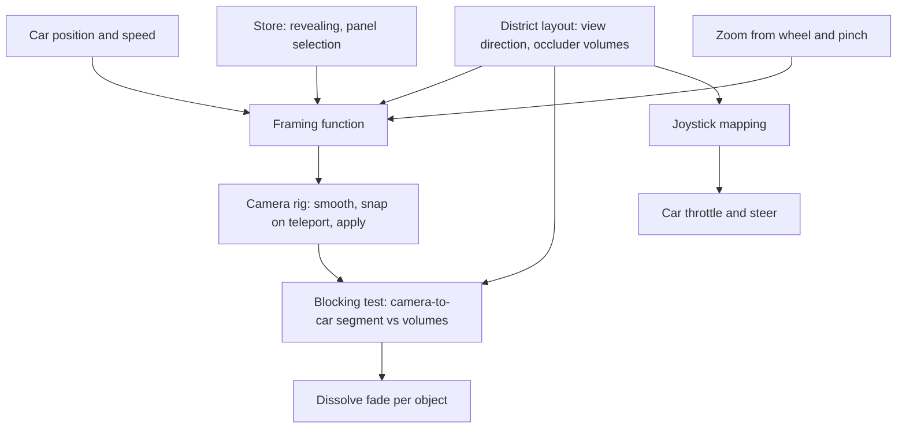
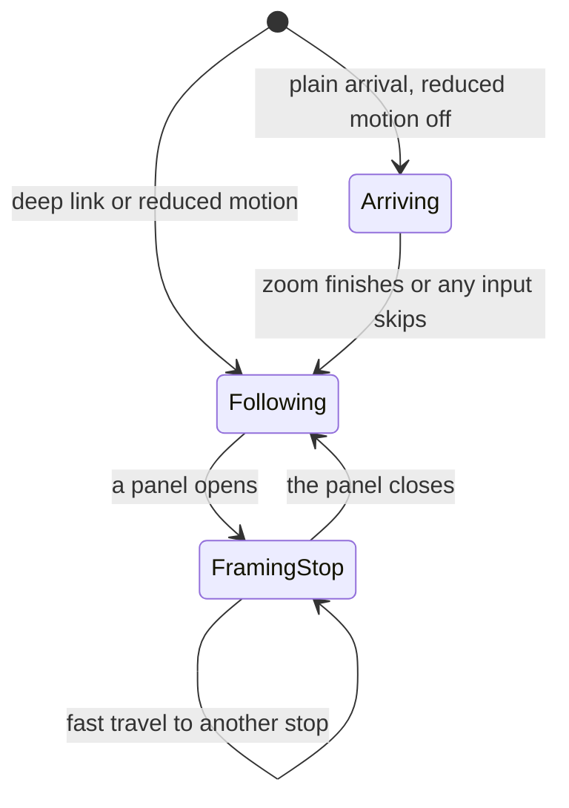

# Isometric Follow Camera - Plan

## Goal Capsule

- **Objective:** Visitors see the Career District as a tabletop miniature, with the car centred in its surroundings from a fixed high three-quarter angle, instead of a low view behind the car.
- **Means:** A fixed-direction perspective follow camera looking from the south-west, driven by a pure framing function (KTD1, KTD2).
- **Product authority:** Apu Islam. This plan covers only the camera; logo billboards, section gates, the guided map, and tech footballs are not active scope (see How This Work Fits Together).
- **Stop conditions:** Stop and ask if the south-west view leaves a stop's entrance or sign unreadable, or if the miniature blur cannot hold the high tier's frame-rate floor.
- **Execution profile:** Seven units, landed in order, each as its own commit; U4 and U5 do not depend on the camera units and can land in either order.
- **Who finishes:** `ce-work` implements and verifies locally; Apu tries it in the browser before code review, as in earlier milestones.
- **Open blockers:** None.

---

## Product Contract

Product Contract preservation: changed: R1, AE2, AE3 — "north stays up the screen" became "the world keeps one orientation on screen", and the acceptance examples now name screen directions, because the compass direction was deferred to planning and the chosen south-west view puts north-east at the top of the screen. Confirmed with Apu before writing.

### Summary

The chase camera is replaced by a camera parked high above and to one side of the car at a fixed angle, with slight perspective, that follows the car without ever rotating. Visitors can zoom in and out and nothing else. The opening and panel moments stay in this same view.

### Problem Frame

Today the camera rides low behind the car and turns with it. Visitors see a slice of road ahead and little of the district around them, so the layout, the stops, and the props are hard to take in at a glance. The art direction calls for a golden-hour miniature city, and the current view never shows it as one. Apu supplied a reference screenshot of the wanted look: a high, fixed, three-quarter view looking down on the car, with the world held still around it and soft blur at the top and bottom edges.

### Key Decisions

- **Fixed-angle perspective follow camera.** Matches the reference and keeps the existing fog, shadows, and night lighting working unchanged. (session-settled: user-directed — chosen over a true orthographic isometric view and over a look-ahead camera that leads the car: the reference shows slight perspective, and look-ahead can be added later without rework.) Governs R1, R2.
- **Zoom is the only camera control.** (session-settled: user-directed — chosen over a fully locked camera, drag-to-peek with spring-back, and 90° quarter-turn rotation: zoom covers the need without losing the fixed composition.) Governs R4, R5.
- **Cinematic moments stay in the fixed view.** (session-settled: user-directed — chosen over keeping today's free fly-over and low tower close-up, and over a hybrid with a fixed arrival but a cinematic panel shot: consistency with the driving view.) Governs R7, R8.
- **Keyboard steering stays car-relative; the touch joystick becomes screen-relative.** (session-settled: user-directed — chosen over screen-relative everywhere and over car-relative everywhere: keyboard drivers keep the familiar controls, while thumbs point where to go.) Governs R10, R11.
- **Nothing hides the car.** Without camera rotation there is no other way to see past the 96 m Career Tower and the backdrop buildings. (session-settled: user-approved — chosen over leaving the car hidden behind tall buildings: confirmed in the scoping synthesis.) Governs R3.
- **Readable signs face the camera.** With a fixed angle, signs pointed elsewhere read edge-on or from behind. (session-settled: user-approved — chosen over leaving signs at their current headings: confirmed in the scoping synthesis.) Governs R13.
- **Miniature blur only on the high quality tier.** It is part of the reference look but costs graphics performance. (session-settled: user-approved — chosen over always-on blur: confirmed in the scoping synthesis.) Governs R14.

### Requirements

**View and follow**

- R1. The camera looks down on the car from a fixed high three-quarter angle with slight perspective, and its direction never changes as the car turns, so the world keeps one orientation on screen.
- R2. The camera keeps the car near the centre of the view and follows it smoothly while driving, braking, colliding, and recovering.
- R3. The car is never hidden: any building or tower between the camera and the car becomes see-through while it blocks the view, and returns to normal once it no longer does.

**Zoom**

- R4. Visitors zoom in and out with the scroll wheel, a trackpad pinch, or a touch pinch, between a closest and a farthest limit.
- R5. Dragging on the scene does not move the camera.
- R6. The view zooms out slightly as speed rises, so more road ahead is visible at speed, and settles back when the car slows.

**Arrival and panels**

- R7. On a plain arrival, the opening starts high and wide over the district and settles onto the car in the fixed view, and any key press, click, or tap skips straight to the driving view.
- R8. Opening a stop's panel eases the camera toward that stop and zooms in somewhat, keeping the same angle; closing the panel returns to following the car.
- R9. Clicking or tapping a stop's building travels there and opens its panel, as the earlier version did.

**Steering**

- R10. Keyboard steering is unchanged: W accelerates, S brakes then reverses, A and D steer relative to the car's own nose.
- R11. The touch joystick is screen-relative: pushing it in a direction drives the car toward that direction on screen, turning it as needed.

**Composition and look**

- R12. On a phone in portrait, the default zoom starts farther out than on desktop, so a phone shows a comparable amount of the district.
- R13. The APU ISLAM billboard, the kiosk faces, and the other readable signs face the camera, so their text reads from the fixed view.
- R14. On the high quality tier, the top and bottom edges of the view are softly blurred to give a tabletop-miniature look; lower tiers show the view without it.
- R15. With reduced motion on, the arrival zoom is skipped and panel camera moves happen instantly.

### Acceptance Examples

- AE1. **Covers R3.** Given the car drives along the road behind the Career Tower as seen from the camera, when the tower is between the camera and the car, then the tower turns see-through and the car stays visible the whole time.
- AE2. **Covers R10.** Given the car is driving toward the bottom of the screen, when the visitor holds A, then the car turns toward its own left, which is the visitor's right on screen.
- AE3. **Covers R11.** Given the car faces the top of the screen, when a phone visitor pushes the joystick toward the bottom of the screen, then the car turns around and drives down the screen without needing a reverse input.
- AE4. **Covers R7, R15.** Given reduced motion is off, when a visitor arrives on the plain district URL, then the view starts high and wide and settles onto the car; given reduced motion is on, the view starts on the car.
- AE5. **Covers R8.** Given the car is parked in the Career zone, when the visitor presses E, then the camera eases toward the Career Tower and zooms in at the same angle, and the panel opens beside it.
- AE6. **Covers R4, R5.** Given the visitor scrolls past the farthest zoom limit, then the view stops at that limit; when the visitor drags across the scene, the view does not move.

### Success Criteria

- Side by side with Apu's reference screenshot, the driving view reads as the same kind of shot: high, fixed, three-quarter, with the car centred.
- Frame rate on the high tier stays at the existing desktop target with the blur on, and the blur never appears on lower tiers.
- The existing browser smoke tests (drive into the Career zone, the pond, the cones, fast travel) still pass under the new camera.

### Scope Boundaries

- A look-ahead lead, where the camera drifts ahead of the car in the travel direction, is deferred.
- Camera rotation of any kind, including drag-to-peek and 90° turns, is out.
- A manual camera-mode switch back to the chase camera is out.
- Moving or restyling buildings and stops beyond turning signs to face the camera (R13) is out.
- Considered and not built: trees turning see-through. Canopies are low and narrow, so the car is only briefly covered; a visual pass showing the car hidden under trees for more than about a second would change this.
- Considered and not built: keyboard zoom keys. Nobody asked for them, and scroll and pinch cover R4.

<!-- ce-section: work-relationships -->
### How This Work Fits Together

This plan covers the isometric follow camera only. The rest of Apu's request is the current understanding of later work, not a committed roadmap:

- **Section gates with showcase billboards:** gates before each section, lined with billboards carrying Apu's logos and project screenshots from `assets/My Items/`, a short description, and details on interaction. Depends on this plan's fixed view direction (KTD1), which decides which way the billboards face. Still to decide: the screenshots are 1–2.7 MB each and need resizing to fit the 8 MB download budget.
- **Guided map with lettered destinations:** a map marking each section by letter (R for Research) with travel to it. Shares the section layout with the gates work and can proceed independently of this plan.
- **Tech-stack footballs:** draggable, kickable balls carrying Python and other tech icons. Can proceed independently of this plan; dragging in the scene must coexist with R5, which keeps drags from moving the camera.

### Dependencies / Assumptions

- Click-to-travel on buildings (R9) was chosen in an earlier session and is advertised in `README.md`, but the current district does not wire it up: `src/world/scene/Selectable.tsx` exists and nothing uses it.
- The opening reveal, panel framing, speed-based view widening, and drag-to-orbit live in `src/world/camera/ChaseCamera.tsx` and `src/world/camera/reveal.ts`; this plan replaces that behavior.
- The touch joystick in `src/ui/TouchControls.tsx` currently maps the stick car-relative (up = throttle, sideways = steer).
- Rebuilding the billboard model needs Blender, which is installed on the development Mac (5.2.2) and driven by `npm run assets:build`.

---

## Planning Contract

### Key Technical Decisions

- KTD1. **The camera looks from the south-west, about 45° down, with a narrow field of view.** From there the Career Tower's west-facing entrance and the kiosks' south-facing boards are already in view, and buildings show two faces, the classic isometric look. A field of view near 30–35° keeps the perspective gentle, as in the reference. The view direction is one constant in `src/world/district/layout.ts`, the layout's single source of truth, because the camera, the joystick mapping (KTD7), and the Blender billboard build (U6) all read it. Implements R1, R11, R13.
- KTD2. **A pure framing function decides where the camera stands; the component only smooths and applies it.** Inputs are the car's position, zoom, speed, viewport aspect, and the arrival and panel blends; output is a camera position and look-at point. This mirrors the pure modules `src/world/camera/reveal.ts` and `src/world/physics/vehicle.ts`, and makes the framing testable without WebGL.
- KTD3. **Zoom moves the camera along the fixed direction; it does not change the field of view.** The visitor's zoom sets a base distance within limits, speed adds a small extra distance (R6), a portrait viewport multiplies the default (R12), and an open panel scales it down (R8). Changing the field of view instead would alter the perspective strength and drift from the reference look.
- KTD4. **Teleports cut the camera; ordinary motion glides.** When the car moves more than about 15 m in one frame (fast travel, deep links, recovery), the follow point snaps instead of easing across the city. Confirmed with Apu in the scoping synthesis.
- KTD5. **Blocking is decided from layout-derived volumes, not GPU raycasts.** Each fadeable object (the tower, each backdrop building, each kiosk, the billboard, the gate) gets a box sized to its visual height, derived from the layout. Each frame the camera-to-car segment is tested against those boxes. This is cheap, deterministic, testable, and independent of mesh detail. The existing collider list cannot serve, because some colliders are shorter than the visuals (the billboard's collider covers only its posts).
- KTD6. **See-through means a dithered dissolve, not alpha blending.** A blocking object dissolves into a fine screen-space dot pattern driven by a per-object fade amount injected into its existing materials. It keeps depth writes, so it never mis-sorts against the tower's glass and stays correct under ambient occlusion and shadows. Each fadeable object gets its own material copies, since backdrop buildings share materials across clones. Confirmed with Apu in the scoping synthesis.
- KTD7. **The screen-relative joystick is converted to the existing throttle and steer before physics.** A pure mapping turns the stick direction plus the view direction (KTD1) into a desired world heading, then into car-relative throttle and steer for the current car heading. The vehicle model, keyboard path, and input combining stay untouched. When the desired heading is far behind the car, the mapping keeps a forward throttle with full steer, so the car turns around rather than reversing (AE3).
- KTD8. **The miniature blur is the tilt-shift effect shipped with the installed post-processing library, added to the existing high-tier effect stack.** `@react-three/postprocessing` 3.2.0 exports `TiltShift2`, and `src/world/lighting/PostFx.tsx` already renders only on the high tier, so R14's tier rule needs no new gating.
- KTD9. **Arrival keeps the existing reveal state and skip handling and replaces only the camera path.** The `revealing` flag in the store, the skip-on-any-input listeners in `src/world/World3D.tsx`, the welcome-card hiding, and the skip hint stay. The key-pose sweep becomes a zoom from a high wide framing of the district onto the car, shortened from 7 s to about 4.5 s, since a straight zoom needs less time than a sweep.

### High-Level Technical Design

How the pieces feed the camera and the fade:

The camera's three framing states, all at the same view direction (R1, R7, R8):

### Assumptions

- Viewing from the south-west keeps every stop readable without moving any building; only the billboard turns (U6). The stop condition in the Goal Capsule covers the case where a visual pass disproves this.

### Sequencing

U1 first, since U2 and U3 build on the camera rig. U6's billboard turn needs the view direction from U1. U4 and U5 are independent of the camera units. U7 runs last.

---

## Implementation Units

### U1. Fixed-view camera rig

**Goal:** Replace the chase camera with the fixed south-west follow camera, including zoom limits, speed zoom-out, and portrait framing.

**Requirements:** R1, R2, R4, R5, R6, R12; KTD1, KTD2, KTD3, KTD4.

**Dependencies:** None.

**Files:**
- Create `src/world/camera/framing.ts` (pure framing function and zoom limits)
- Create `src/world/camera/framing.test.ts`
- Create `src/world/camera/FollowCamera.tsx` (component: input, smoothing, apply, panel view offset)
- Delete `src/world/camera/ChaseCamera.tsx`
- Modify `src/world/district/layout.ts` (view direction constant)
- Modify `src/world/World3D.tsx` (mount the new camera; initial camera position)

**Approach:**
1. Add the view direction (azimuth and elevation) to the layout so the camera, the joystick, and the billboard share it.
2. Write the framing function: the camera stands at the follow point plus the view direction times the distance from KTD3; the look-at point is the follow point slightly above ground.
3. In the component, damp the follow point toward the car, snap on teleport (KTD4), and apply position and look-at each frame.
4. Wire scroll and two-pointer pinch on the canvas to the zoom value, clamped to the limits, and remove the drag-orbit handlers (R5).
5. Carry over the panel view offset from the chase camera, so the subject stays clear of the open info panel.

**Patterns to follow:** `src/world/camera/ChaseCamera.tsx` (damping, view offset, wheel handling), `src/world/carRef.ts` for reading the car body and visual.

**Test scenarios:**
- Given the car at the origin at rest with default zoom, the camera stands south-west of and above the car at the configured elevation, and looks at a point at the car.
- Given the car at two different headings, the camera's direction from the car is identical for both (R1).
- Given a zoom request beyond the farthest limit, the framing distance equals the farthest limit; beyond the closest, the closest (AE6).
- Given speed 0 and then top speed with the same zoom, the distance at top speed is larger by the configured speed extra and no more (R6).
- Given a portrait aspect (0.5) and a landscape aspect (1.6) at default zoom, the portrait distance is larger (R12).
- Given the follow point 20 m away from the car in one frame, the rig reports a snap rather than an ease (KTD4).

**Verification:** In the browser the view matches the reference shot's angle, does not rotate when the car turns, zooms only with scroll or pinch, and dragging does nothing.

### U2. Arrival and panel framing in the fixed view

**Goal:** Make the opening zoom and the panel framing happen inside the fixed view, with reduced-motion variants.

**Requirements:** R7, R8, R15; KTD2, KTD3, KTD9.

**Dependencies:** U1.

**Files:**
- Modify `src/world/camera/reveal.ts` (arrival blend over about 4.5 s, replacing the key-pose sweep)
- Create `src/world/camera/reveal.test.ts`
- Modify `src/world/camera/framing.ts` (arrival and panel blends as inputs)
- Modify `src/world/camera/framing.test.ts`
- Modify `src/world/camera/FollowCamera.tsx`
- Modify `src/world/district/layout.ts` (remove the old `REVEAL` key poses once unused)

**Approach:**
1. The arrival blend goes from 0 to 1 over the reveal time: at 0 the framing centres on the district at a wide distance; at 1 it is the normal follow framing.
2. The panel blend eases the follow point toward the open stop's focus on the ground and scales the distance down (KTD3). Closing eases back.
3. With reduced motion, the arrival blend starts at 1 and the panel blend jumps to its target (R15).
4. The skip-on-input path and the `revealing` flag are unchanged (KTD9).

**Patterns to follow:** the current `revealPose` hand-off into the live chase pose in `src/world/camera/reveal.ts`; the panel blend smoothing in `src/world/camera/ChaseCamera.tsx`.

**Test scenarios:**
- Covers AE4. Given arrival time 0, the framing centre is the district centre and the distance is the wide arrival distance; at the reveal time, the framing equals the plain follow framing for the same car.
- Given the arrival halfway, the camera direction is still the fixed view direction (R1 holds during arrival).
- Covers AE5. Given a full panel blend for the Career Tower, the framing centre is at the tower's focus and the distance is smaller than the follow distance at the same zoom.
- Given reduced motion on, the arrival blend reported at time 0 is already complete.

**Verification:** A plain arrival zooms from high and wide onto the car with no change of angle; pressing E in the Career zone eases toward the tower, and Esc eases back.

### U3. See-through blocking buildings

**Goal:** Dissolve any tall object that stands between the camera and the car, and restore it once clear.

**Requirements:** R3; KTD5, KTD6.

**Dependencies:** U1.

**Files:**
- Create `src/world/district/occluders.ts` (layout-derived volumes, one per fadeable object, keyed by name)
- Create `src/world/district/occluders.test.ts`
- Create `src/world/scene/dissolve.ts` (makes an object's materials fadeable via a per-object amount)
- Create `src/world/camera/OcclusionFade.tsx` (per-frame blocking test and eased fade)
- Modify `src/world/scene/District.tsx` (register the tower, each building clone, and each kiosk as fadeable)
- Modify `src/world/scene/Billboard.tsx` (register the billboard as fadeable)
- Modify `src/world/World3D.tsx` (mount the fade controller)

**Approach:**
1. Derive one box per fadeable object from the layout, sized to its visual height rather than its collider (KTD5).
2. Each frame, test the segment from the camera to a point just above the car against every box, and also test two points at the car's front and back, so the car does not half-vanish.
3. Ease each object's fade toward 1 while it blocks and back to 0 once clear, over roughly 0.25 s, so passing behind a building does not flicker.
4. The dissolve patches each fadeable object's own material copies (KTD6) when the scene loads, so the extra shader variant compiles behind the loading screen rather than as a hitch the first time a building blocks the view mid-drive.

**Patterns to follow:** `src/world/district/colliders.ts` for deriving volumes from the layout; `src/world/carRef.ts` for a module-level registry shared between scene components.

**Test scenarios:**
- Covers AE1. Given the camera south-west of the car and the Career Tower box between them, the blocking test returns the tower.
- Given the car in open road with nothing between it and the camera, the blocking test returns nothing.
- Given a building beside the segment but not crossing it, the blocking test does not return it.
- Given the billboard between camera and car at a height above its posts, the blocking test returns the billboard (its volume uses the visual height, not the collider).
- Given each building in the layout, its occluder volume encloses that building's footprint and height.
- Integration: given a building marked fully faded, its materials discard pixels in the dither pattern and other clones of the same building model are unaffected.
- Integration: given the district has loaded, every fadeable object already carries its patched material copies before any fade is requested.

**Verification:** Driving behind the Career Tower and the backdrop buildings keeps the car visible, the buildings dissolve smoothly and restore after, and no glass sorting artefacts appear.

### U4. Screen-relative touch joystick

**Goal:** Make the touch joystick drive toward the pushed screen direction while the keyboard keeps today's steering.

**Requirements:** R10, R11; KTD1, KTD7.

**Dependencies:** None (reads the view direction constant; if U1 has not landed, add the constant here).

**Files:**
- Create `src/world/drive/screenSteer.ts` (pure stick-to-drive mapping)
- Create `src/world/drive/screenSteer.test.ts`
- Modify `src/world/drive/input.ts` (touch stick vector alongside the existing touch input)
- Modify `src/ui/TouchControls.tsx` (write the stick vector instead of throttle and steer)
- Modify `src/world/scene/Car.tsx` (map the stick to throttle and steer using the car's heading before the existing input combining)

**Approach:**
1. The joystick writes a normalised screen-space stick vector, with the existing dead zone.
2. The car converts it to a desired world heading through the view direction, then to throttle and steer against its current heading (KTD7).
3. Keyboard input still wins whenever a key is held, through the existing combining.

**Patterns to follow:** `src/world/drive/input.ts` pure input helpers; `headingOf` in `src/world/physics/vehicle.ts`.

**Test scenarios:**
- Given the stick pushed toward the top of the screen and the car already heading that way, steer is near 0 and throttle is positive.
- Covers AE3. Given the car facing the top of the screen and the stick pushed toward the bottom, throttle stays positive and steer is at full lock, with no reverse.
- Given the stick pushed to the right of the screen and the car facing up the screen, steer turns the car toward screen-right.
- Given a stick vector inside the dead zone, throttle and steer are both 0.
- Given a partially pushed stick, throttle scales with the stick's length.
- Given keyboard input held at the same time as the stick, the keyboard's car-relative input is used unchanged (R10). AE2 itself stays covered by the existing mirrored-steering test in `src/world/physics/vehicle.test.ts`, since the keyboard path does not change.

**Verification:** On a phone, pushing the joystick in any direction drives the car that way on screen; on a keyboard, steering feels as it does today.

### U5. Click-to-travel on stops

**Goal:** Restore clicking or tapping the Career Tower or a kiosk to travel there and open its panel.

**Requirements:** R9.

**Dependencies:** None.

**Files:**
- Modify `src/world/scene/District.tsx` (wrap the tower and each `kiosk_<section>` node in the existing selectable wrapper)
- Modify `e2e/smoke.spec.ts` (click the tower; covered in U7)

**Approach:**
1. Wrap the tower model in the selectable wrapper for the Career section.
2. Render each kiosk node from the kiosks model as its own selectable, mapped from its node name to its section.
3. Keep the wrapper's existing drag tolerance, so a pinch or brief drag never counts as a click.

**Patterns to follow:** `src/world/scene/Selectable.tsx` as written for the earlier landmarks; `labelIdFor` in `src/world/labels.ts` for hover highlighting.

**Test scenarios:**
- Test expectation: browser-level only. Clicking the projected centre of the Career Tower opens the Career panel at the Career parking spot (U7), since the 3D layer is stubbed in jsdom.

**Verification:** Hovering a stop highlights its label and shows a pointer cursor; clicking it travels there and opens the panel.

### U6. Billboard faces the camera; miniature blur

**Goal:** Turn the APU ISLAM billboard toward the camera and add the tilt-shift blur on the high tier.

**Requirements:** R13, R14; KTD1, KTD8.

**Dependencies:** U1 (view direction).

**Files:**
- Modify `src/world/district/layout.ts` (billboard heading derived from the view direction)
- Modify `src/world/district/layout.test.ts`
- Rebuild `public/models/billboard.glb` with `npm run assets:build -- billboard`
- Modify `src/world/lighting/PostFx.tsx` (add the tilt-shift effect)

**Approach:**
1. Set the billboard's heading so its face points along the view direction toward the camera; its post colliders already follow the layout heading.
2. Rebuild only the billboard model and confirm the model budget still passes.
3. Add the tilt-shift effect to the high-tier effect stack with a sharp band wide enough to keep the car and the road ahead in focus.

**Patterns to follow:** `BILLBOARD` in `src/world/district/layout.ts` and its use in `assets/blender/models/billboard.py`; the existing effect stack in `src/world/lighting/PostFx.tsx`.

**Test scenarios:**
- Given the layout, the billboard's facing direction is within 10° of pointing at the camera along the view direction.
- Given the layout, the billboard's post colliders still sit off the roads and away from the spawn point (existing layout tests keep passing).
- Test expectation for the blur: none in unit tests, since it is a visual effect; checked by the frame-rate sample and a visual pass in U7.

**Verification:** From the default view the billboard reads face-on; on the high tier the top and bottom edges blur while the car stays sharp; medium and low tiers show no blur.

### U7. Browser verification and docs

**Goal:** Prove the new camera in a real browser and update the visitor-facing controls.

**Requirements:** R1, R5, R9; Success Criteria.

**Dependencies:** U1–U6.

**Files:**
- Modify `e2e/smoke.spec.ts`
- Modify `src/ui/Hud.tsx` (in-app controls card: scroll or pinch to zoom; the joystick drives toward where you push it)
- Modify `src/App.test.tsx`
- Modify `README.md` (controls table: no drag-to-look, pinch to zoom, screen-relative joystick)

**Approach:**
1. Add a check that the camera's orientation is unchanged after holding a steering key for two seconds.
2. Add a check that scrolling changes the camera distance and stops at the limit, and that dragging leaves it unchanged.
3. Add a click on the Career Tower's projected screen point and expect the Career panel.
4. Update the in-app controls card and the README to the new controls, so visitors can discover zoom.
5. Keep the existing smoke tests unchanged and passing.

**Patterns to follow:** the opt-in test hooks in `src/world/testHooks.ts` and the existing specs in `e2e/smoke.spec.ts`.

**Test scenarios:**
- Given the car driving and turning, the camera quaternion before and after the turn is identical within rounding (R1).
- Given repeated scroll-out, the camera distance stops growing at the farthest limit; a drag leaves the camera position unchanged (AE6).
- Given a click on the Career Tower, the Career panel opens and the URL ends in `/3d/experience` (R9).
- Given the existing Career-zone, pond, cones, and fast-travel tests, all still pass.
- Given the controls card opened on desktop, it lists scroll to zoom; given a touch device, it lists pinch to zoom and describes the joystick as driving toward where you push it.

**Verification:** The full browser suite passes, and the frame-rate report at 1440×900 is recorded.

---

## Verification Contract

| Gate | Command | Proves |
| --- | --- | --- |
| Types | `npm run typecheck` | Every unit compiles under the project's strict settings |
| Unit and integration | `npm test` | Framing, arrival and panel blends, blocking volumes, joystick mapping, layout, existing suites |
| Browser | `npm run test:e2e` | Fixed orientation, zoom limits, click-to-travel, and the existing smoke tests in Chrome |
| Billboard model | `npm run assets:build -- billboard` | The turned billboard rebuilds and the model budget passes |
| Download budget | `npm run build` then `npm run budget` | The total 3D download stays under 8 MB |
| Visual pass | Open the dev server at noon, sunset, and night | The view matches the reference, buildings dissolve when blocking, the billboard reads face-on, and the blur shows only on the high tier |

---

## Definition of Done

- Every unit's verification holds, and all gates in the Verification Contract pass.
- `src/world/camera/ChaseCamera.tsx` and the unused `REVEAL` key poses are removed, with no references left.
- No dead-end or experimental code from abandoned approaches remains in the diff.
- The in-app controls card and `README.md` describe the new camera controls.
- Each unit lands as its own commit.
