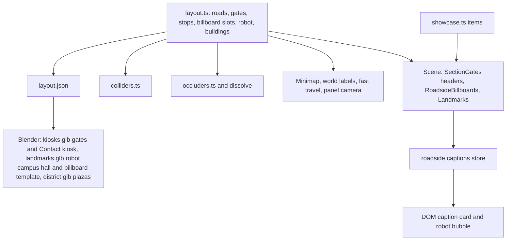
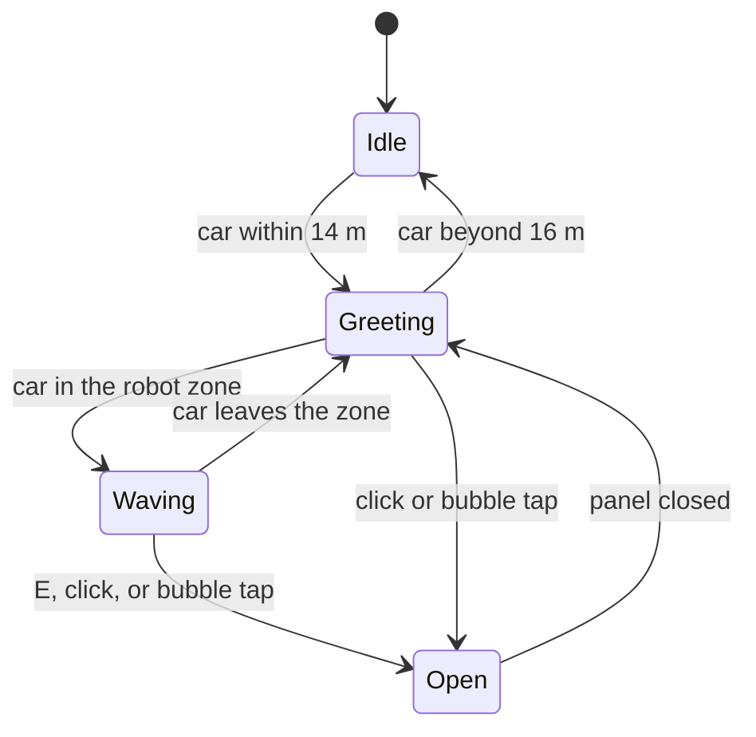

# Section Roads - Plan

## Goal Capsule

- **Objective:** Each section of Apu's portfolio is its own place in the district. A visitor drives through a section's gate and finds that section's items along the road: big readable billboards, a SeCAREly robot that greets them, a Projects building, and a small campus. Each opens its details on interaction.
- **Means:** One road per section (Key Decisions), with layout-driven placement (KTD1), far-side roadside content (KTD2), and runtime-painted faces (KTD3).
- **Product authority:** Apu Islam. Content comes from `src/content/portfolio.ts`, unchanged except where R13 says.
- **Open blockers:** None.
- **Stop conditions:** Stop and ask if a road cannot hold its items without billboards overlapping in the camera view (R5), or if the robot cannot stand in the road and still leave both lanes drivable (R8).
- **Who finishes:** `ce-work` implements and verifies locally. Apu drives the result before any code review.

---

## Product Contract

### Summary

The five sections move apart, one road each: Work on the cross street, Research on the east road, Projects on the north road, Education on the west road, and Contact on the south road near the start. Gates keep their frames and lettered header signs but lose the item screens. Past each gate, the section's content stands beside the road. Work and Education get one big billboard per item, and Research gets one per paper. Research also has a robot standing in the road that greets the car with SeCAREly text and opens the SeCAREly paper. Projects become one building that opens the project list, and Education gets a small university building.

### Problem Frame

The gates cram every item onto two small screens that page every seven seconds, so a visitor reads one or two titles and never sees the rest. All five stops also sit along the north road, so the district has one busy street and four empty ones. Apu wants each section to feel like a place you arrive at, with its items big enough to read as you drive past.

### Key Decisions

- **One road per section.** (session-settled: user-directed — Apu chose "one road each" over keeping the stops together on the north road.) Governs R1, R2.
- **Gates show only the header sign.** Items move to roadside billboards, the robot, and the buildings. (session-settled: user-directed — Apu asked that items not appear on the gates.) Governs R3.
- **Research leads with a robot in the road for SeCAREly; other papers get billboards.** (session-settled: user-directed — Apu described the robot and its hover text.) Governs R7, R8, R9.
- **Projects get one building and no billboards.** (session-settled: user-approved — proposed in the scoping summary, following Apu's "combine all projects in one building".) Governs R10.
- **The robot is solid and cannot be knocked over.** (session-settled: user-approved — proposed in the scoping summary.) Governs R8.
- **Billboards keep the sharp caption card the gates had.** (session-settled: user-approved — proposed in the scoping summary.) Governs R6.
- **The Research, Projects, and Education kiosks are removed; the Contact kiosk moves to the south road.** (session-settled: user-approved — proposed in the scoping summary.) Governs R10, R11, R12.

### Requirements

**Layout**

- R1. Each section owns one road: Work the cross street, Research the east road, Projects the north road, Education the west road, Contact the south road west of the start.
- R2. A visitor touring counter-clockwise from the start (east along the south road) passes each section's gate before that section's items and stop.
- R3. Each gate keeps its pillars, beam, lanterns, and lettered header sign, with no item screens.

**Billboards**

- R4. Work has one billboard per role (4), Research one per paper other than SeCAREly (8), Education one per degree (2), and Contact one billboard with the email, GitHub, and résumé.
- R5. Billboards stand on the side of their road away from the camera, face the camera, and never overlap each other or hide the road in the default view.
- R6. Each billboard shows the item's logo or image, title, subtitle, and one-line description. When the car is near, the sharp caption card repeats it, and clicking or tapping the board or the card opens that item's details.

**Research robot**

- R7. A friendly robot stands in the middle of the east road just past the Research gate, turns toward the car, and idles gently.
- R8. The robot is solid, leaves both lanes drivable, and the car stops against it rather than knocking it over.
- R9. Within about 14 m of the robot, a speech bubble over it shows SeCAREly hover text: a short greeting, the paper's title, and its one-line description. Pressing E in its zone, or clicking the robot or the bubble, opens the SeCAREly paper.

**Buildings and stops**

- R10. One Projects building on the north road, signed and showing the project screenshots on its front, opens the full project list on E in its zone or a click.
- R11. A small university-style building on the west road, past the degree billboards, opens the Education panel on E in its zone or a click.
- R12. The Contact kiosk stands on the south road west of the start and opens the Contact panel as before. The Career Tower stays where it is and stays the Work stop.

**Everything that follows the stops**

- R13. Fast travel, the minimap letters, the floating stop names, the E prompt, and the panel camera all point at the new stop positions, and the prompt names the stop ("Press E to talk to the SeCAREly robot").
- R14. Every new structure is solid where it looks solid, dissolves when it hides the car, and glows at night like the gates.

### Acceptance Examples

- AE1. **Covers R9.** Given the car drives north past the Research gate, when it comes within about 14 m of the robot, then the bubble shows "SeCAREly" text. When it parks in front and presses E, then the Research panel opens on the SeCAREly paper.
- AE2. **Covers R6.** Given the car drives along the east road, when it passes the third paper billboard, then the caption card shows that paper. Clicking the card opens that paper.
- AE3. **Covers R10.** Given fast travel to P, then the car parks in front of the Projects building, and E opens a panel listing all seven projects.

### Success Criteria

- At the default zoom, with the car beside a billboard, its title reads in a screenshot without the caption card.
- Asset total stays under the 8 MB budget, and the desktop drive sample stays at or above the fps it reports today.

### Scope Boundaries

- Considered and not built: E-to-open on each billboard. Billboards sit about 9 m apart, so their zones would flicker the prompt on every few meters of road. Click, tap, and the caption card open them instead. Revisit if Apu finds clicking awkward on touch.
- Considered and not built: a robot chat, voice, or sound. The bubble text and the panel carry the content.
- Considered and not built: project billboards. The building stands for all seven projects (Key Decisions).
- The football pitch, the name billboard, the pond, and the props plaza stay where they are.

---

## Planning Contract

### Key Technical Decisions

- KTD1. **The layout module stays the single source for every new position.** Gates, stops, billboard slots, the robot, and the buildings are data in `src/world/district/layout.ts`. Colliders, occluders, the minimap, labels, trees, lamps, and the Blender build all read them, as the gates do today.
- KTD2. **Roadside content stands on the far side of each road from the camera.** The camera looks north-east from the south-west, so that is north of east–west roads and east of north–south roads. Content there cannot come between the camera and a car on the road. The dissolve stays as a backstop.
- KTD3. **Billboard frames are one Blender template, cloned per slot; faces are canvas textures painted once at runtime.** Placement changes then need no model rebuild, and each face shows one item, so the gates' paging goes away. The frame's face is about 7 m × 3.9 m (16:9), raised above car height and leaned back like `GATE_FRAME.screen.tilt`, so the high camera sees it nearly face-on. Its dimensions live in the layout, and U1's projected-overlap test and U4's legibility test set the final size. Face textures are 768×432 on high tiers and 512×288 on low tiers, which keeps 15 faces near 20 MB of texture memory.
- KTD4. **Billboard slots are listed in the layout, and a test pairs them with the content.** Each section's slot count must equal its showcase item count, minus SeCAREly for Research, with two exceptions. Projects has no slots (one building, per the Key Decisions), and Contact's email, GitHub, and résumé entries share its single slot (R4). Adding a paper fails the test until a slot is added, instead of silently dropping the item.
- KTD5. **A stop opens a selection, not only a section.** Zones carry the selection they open (`{ section: 'research', itemId: 'secarely' }` for the robot), and the store's near-stop state, the E key, the touch button, and the prompt use it. The zone's name feeds the prompt. Clicks on a billboard or its caption card open the item with `travel: false`, and while the open item has a roadside slot the panel camera frames that slot instead of the section's stop. Otherwise a click on a board 70 m down the road would move the car back to the stop.
- KTD6. **The robot, campus, and Projects building are a new Blender model, `landmarks.glb`, built at the origin and placed from the layout.** Kiosks and gates stay in `kiosks.glb`, which keeps only the Contact kiosk. Named robot parts (head, arms, eyes) let the runtime turn the head, bob, and wave without baked animation.
- KTD7. **One roadside caption system replaces the gate captions.** It shows the nearest billboard's card within 18 m, and the robot's bubble within 14 m. While the bubble is visible the card is hidden, because the first paper board stands close enough to the robot on screen for the two to cover each other. It generalizes `src/world/gateCaptions.ts` and `GateCaptionProjector.tsx`.

### High-Level Technical Design

The layout feeds every consumer. The Blender build reads the exported JSON, and the runtime reads the module directly.

Robot states, driven by distance from the car and reduced motion:

Idle bobs and turns its head slowly toward the car. Greeting shows the bubble. Waving adds an arm wave. With reduced motion the robot holds still, and the bubble still shows.

### Starting Layout

These are starting coordinates, in meters (+X east, +Z south). Units may shift them to pass the layout tests in U1. The loop's straights are z = ±55 for x in [-50, 50] and x = ±70 for z in [-35, 35]. The cross street is x = 0.

| Section | Gate (center, faces) | Items beside the road | Stop and zone |
| --- | --- | --- | --- |
| Work | (0, 40), faces south | 4 role boards east of the street at x ≈ 10.5, z = 32, 22, 12, 2 | Career Tower, zone (2.5, -18) unchanged |
| Research | (70, 32), faces south | Robot in the road at (70, 22). 8 paper boards east of the road at x ≈ 81, z = 14 down to -49, 9 m apart | Robot zone centered on the robot, radius 7, parking (67.5, 28) heading north |
| Projects | (40, -55), faces west | None | Projects building at (12, -75), about 18×12 m. Zone (12, -57.5), parking (15, -57.5) heading west |
| Education | (-70, -30), faces south | 2 degree boards east of the road at x ≈ -59, z = -20, -10 | Campus at (-56, 12), about 14×10 m. Zone (-67.5, 12), parking (-67.5, 8) heading south |
| Contact | (-48, 55), faces west | 1 contact board north of the road at (-40, 46) | Kiosk at (-28, 46). Zone (-28, 52.5), parking (-25, 52.5) heading east |

The start moves east to (-18, 57.5), still heading east, so a counter-clockwise tour ends at Contact (R2). The `kiosks` promenade plaza becomes a small forecourt in front of the Projects building. Park bench `bench-0` at (-50, 8) moves clear of the campus.

### Implementation Units

### U1. Section roads in the layout

- **Goal:** Move the gates, stops, and start, and add billboard slots, the robot, and the buildings to the layout, with colliders and occluders derived from them.
- **Requirements:** R1, R2, R5, R8, R12, R14 (governed by the Key Decisions on one road per section and on the kiosks).
- **Dependencies:** None.
- **Files:** `src/world/district/layout.ts`, `src/world/district/colliders.ts`, `src/world/district/occluders.ts`, `src/world/district/layout.test.ts`, `src/world/district/occluders.test.ts`, `src/world/scene/District.tsx` and `src/world/district/assets.test.ts` (their kiosk references switch to `CONTACT_KIOSK`, so this unit's commit typechecks and passes on its own).
- **Approach:**
  1. Replace `KIOSKS`, `KIOSK_Z`, and the kiosk zone helper with per-section stop data from the Starting Layout table. Zones gain the selection they open (KTD5).
  2. Add `ROADSIDE_BILLBOARDS` slots per section (KTD4), billboard frame dimensions and lean (KTD3), `ROBOT`, `CAMPUS`, `PROJECTS_HALL`, and the moved `CONTACT_KIOSK`.
  3. Move `SECTION_GATES` to each road's entrance and `SPAWN` to (-18, 57.5). Replace the `kiosks` plaza with a Projects forecourt, and move `bench-0`.
  4. Keep trees and lamps clear of gates, slots, the robot, and the buildings.
  5. Derive colliders for billboard posts, the robot (a cylinder), the buildings, and the Contact kiosk, and occluders for each, keyed `roadside-<item id>`, `robot`, `campus`, `projects-hall`, `kiosk-contact`.
- **Patterns to follow:** `SECTION_GATES` and `gatePoint`, `BUILDINGS` with `BUILDING_HALF`, and the existing clearance tests in `layout.test.ts`.
- **Test scenarios:**
  - Each section's gate straddles its own road, with both pillars off the paved width.
  - Each section's slots and building lie past its own gate in the counter-clockwise direction of travel (R2) and before the next section's gate, on the far side from the camera (KTD2). The robot stands on the east road's centre line past the Research gate, ahead of the paper boards, and relies on the dissolve for occlusion.
  - Projecting each billboard face through `VIEW.heading` and `VIEW.elevation`, no two projected face rectangles overlap (R5).
  - Slot counts follow KTD4: Work 4, Research 8 with SeCAREly excluded, Education 2, Contact 1, Projects 0.
  - The robot stands on the road, and both lanes beside it leave at least 3.5 m clear of its collider (R8).
  - No billboard or building overlaps a road. No billboard, building, or the robot overlaps a plaza, the pitch, the pond, the tower, a backdrop building, or another structure. The existing off-road collider test exempts the robot collider, which R7 places on the road and the lane-clearance scenario covers.
  - The start lies on the road, more than 3 m from every collider, with the name billboard ahead and to the right.
  - `zoneFor` returns a zone for every section, and the research zone opens `secarely`.
  - A billboard slot and the robot report as blocking when they sit between the camera and the car.
- **Verification:** The layout and occluder tests pass with the new data, and the old kiosk and gate-distance tests are rewritten, not deleted.

### U2. Stops open what they stand for

- **Goal:** Let a zone open a specific item and name itself in the prompt.
- **Requirements:** R9, R13 (KTD5).
- **Dependencies:** U1.
- **Files:** `src/state/store.ts`, `src/App.tsx`, `src/ui/Hud.tsx`, `src/world/scene/Car.tsx`, `src/world/labels.ts`, `src/ui/Minimap.tsx`, `src/App.test.tsx`, `src/state/route.test.ts`.
- **Approach:** The near-stop state holds the zone's selection and name. The E key and the touch button navigate to that selection with `travel: false`. Fast travel to a section still uses `zoneFor(section)`, so R lands at the robot. World labels and minimap markers read the new zones unchanged, and the robot's floating label hides while its bubble shows (U5).
- **Patterns to follow:** The current `nearTower` flow through `Car.tsx`, `App.tsx`, and `InteractPrompt`.
- **Test scenarios:**
  - Covers AE1. With the near-stop state set to the robot zone, pressing E opens Research with item `secarely`.
  - With the near-stop state on the Projects zone, E opens the Projects panel with no item.
  - The prompt reads the zone's name ("SeCAREly robot", "Projects Hall").
  - E does nothing while a panel or the menu is open.
- **Verification:** The unit tests pass, and the E prompt names each stop in a dev run.

### U3. Models: plain gates, Contact kiosk, landmarks

- **Goal:** Rebuild the gate frames without the screen divider, keep only the Contact kiosk, and model the robot, campus, Projects building, and billboard template.
- **Requirements:** R3, R7, R10, R11, R12, R14 (KTD6).
- **Dependencies:** U1.
- **Files:** `assets/blender/models/kiosks.py`, `assets/blender/models/landmarks.py` (new), `assets/blender/models/district.py`, `assets/blender/build_all.py`, `public/models/kiosks.glb`, `public/models/landmarks.glb`, `public/models/district.glb`, `src/world/district/assets.test.ts`.
- **Approach:**
  1. In `kiosks.py`, drop the screen divider and rails from `gate_<section>`, and build only `kiosk_contact` at its new spot.
  2. In `landmarks.py`, build `robot` with named children (`robot_head`, `robot_arm_l`, `robot_arm_r`) and an emissive `robot_eye` material. Build `campus` (brick hall, columns, pediment, small clock tower), `projects_hall` (glass-fronted workshop with a sign band and a poster strip), and `roadside_billboard` (two posts, a frame, a cap, and a face slot sized to the layout's frame dimensions). Each is built at the origin.
  3. In `district.py`, plaza curb heights follow the plaza list rather than the `kiosks` name.
  4. Register `landmarks` in `MODELS`.
- **Patterns to follow:** `kiosks.py` (kit helpers, glow materials named per section), `career_tower.py` for building massing, `lib/kit.py`.
- **Test scenarios:**
  - `kiosks.glb` has `gate_<section>` for all five sections and `kiosk_contact` only.
  - `landmarks.glb` has `robot`, `robot_head`, `robot_arm_l`, `robot_arm_r`, `campus`, `projects_hall`, and `roadside_billboard`.
  - Each landmark's bounding box fits its layout footprint within 0.5 m.
- **Verification:** `npm run assets:build -- kiosks landmarks district` succeeds, and the asset tests pass.

### U4. Roadside billboards and their captions

- **Goal:** Place a billboard per slot with its item painted on the face, openable by click, tap, or the caption card. Strip the gate screens.
- **Requirements:** R3, R4, R5, R6, R14 (KTD3, KTD4, KTD7).
- **Dependencies:** U1, U3.
- **Files:** `src/world/scene/RoadsideBillboards.tsx` (new), `src/world/scene/SectionGates.tsx`, `src/world/scene/gateScreens.ts` (renamed `signPaint.ts`), `src/world/scene/gateScreens.test.ts` (renamed to match), `src/world/roadsideCaptions.ts` (from `gateCaptions.ts`), `src/world/roadsideCaptions.test.ts`, `src/world/scene/RoadsideCaptionProjector.tsx` (from `GateCaptionProjector.tsx`), `src/ui/RoadsideCaption.tsx` (from `GateCaptions.tsx`), `src/world/World3D.tsx`, `src/world/scene/District.tsx`, `src/world/camera/FollowCamera.tsx` (frames the open item's slot, KTD5), `src/styles.css`.
- **Approach:**
  1. `SectionGates.tsx` keeps only the header sign per gate.
  2. Remove the paging (`PAGE_SECONDS`, `pageCount`, `screenItem`) and keep `paintHeader` and an item painter sized for one item per face.
  3. `RoadsideBillboards` clones `roadside_billboard` per slot and paints each face once from the slot's showcase item, at the tier's face size (KTD3). The Contact slot uses a contact painter that lists the email, GitHub, and résumé entries on one face titled Contact, and opens the Contact panel with no item. Each board registers its frame and face under the slot's occluder key, and opens its item on click with the existing click tolerance and `travel: false` (KTD5).
  4. The caption store tracks the nearest billboard within 18 m and hides the card while the robot bubble is visible (KTD7). The projector pins the card under that board. The card's title is a button that opens the item with `travel: false`, so touch and keyboard users can open it.
  5. Faces are unlit (`toneMapped: false`), so they glow at night like the old screens.
- **Patterns to follow:** `SectionGates.tsx` image loading and canvas setup, the backdrop-building clones in `District.tsx`, and `Selectable` click handling.
- **Test scenarios:**
  - The item painter fits a long paper title on a 768-wide face in at most three lines and keeps the subtitle and description.
  - The caption store reports the nearest board within 18 m and nothing beyond it.
  - Moving between two boards switches the caption to the nearer one.
  - Covers AE2. Clicking the caption card's title opens that board's item.
  - Each slot's face shows its own item, and no item appears twice.
  - The Contact face lists the email, GitHub, and résumé, and clicking it opens the Contact panel.
  - With the robot bubble visible, the caption store reports no card. Once the bubble hides, the nearest board's card returns.
  - At `ZOOM.default` on a 1600×1000 viewport, a face's title is at least 14 px tall on screen. Titles that do not fit at that size end in an ellipsis rather than shrinking.
  - Opening a paper from its board keeps the car where it is, and the panel camera frames that board.
- **Verification:** In a dev run, each road shows its boards with legible faces at the default zoom, and the gates show only their headers.

### U5. The robot, the Projects building, and the campus

- **Goal:** Place the three landmarks, make them selectable, animate the robot, and show its SeCAREly bubble.
- **Requirements:** R7, R8, R9, R10, R11, R14 (KTD6, KTD7).
- **Dependencies:** U2, U3, U4.
- **Files:** `src/world/scene/Landmarks.tsx` (new), `src/world/scene/robotMotion.ts` (new, pure), `src/world/scene/robotMotion.test.ts`, `src/ui/RobotBubble.tsx` (new), `src/world/World3D.tsx`, `src/world/lighting/Lighting.tsx`, `src/styles.css`.
- **Approach:**
  1. `Landmarks` places `robot`, `campus`, and `projects_hall` from the layout. Each is wrapped in `Selectable`: the robot opens `{ research, secarely }`, the hall opens Projects, the campus opens Education.
  2. Paint the hall's sign band and its poster strip of the seven screenshots into one canvas texture, and the campus sign with `paintHeader`.
  3. `robotMotion` turns distance from the car, zone state, time, and reduced motion into head yaw, bob height, arm angle, and bubble visibility, following the state diagram above.
  4. The bubble's greeting is fixed copy. Its title and line come from the SeCAREly paper in `portfolio.ts`, and tapping it opens the paper.
  5. Register `robot_eye` and the landmark glow materials for night glow, and register each landmark's dissolve.
- **Patterns to follow:** The `Footballs` per-frame loop for car-relative logic, `GateCaptionProjector` for DOM pinning, and the `Lighting.tsx` glow material list.
- **Test scenarios:**
  - The bubble shows at 13 m, stays at 15 m once shown, and hides at 17 m, so it does not flicker at the edge.
  - Head yaw points at the car and is clamped to ±70° from the robot's facing.
  - With reduced motion, bob and arm angle stay at rest and the bubble still shows.
  - Inside the zone, the arm waves. Outside, it does not.
  - Covers AE1. Clicking the bubble opens Research on `secarely`.
- **Verification:** In a dev run, the robot turns to the car, greets it, and opens SeCAREly. The hall shows its screenshots and opens Projects, and the campus opens Education.

### U6. Browser checks, budget, and docs

- **Goal:** Prove the new roads in Chrome, check the budget, and update the README.
- **Requirements:** R1–R14, Success Criteria.
- **Dependencies:** U4, U5.
- **Files:** `e2e/smoke.spec.ts`, `README.md`.
- **Approach:**
  1. Replace the gate-screen test with a billboard test: click a paper board and expect that paper's panel.
  2. Add a robot test (AE1): place the car 12 m south of the robot, expect the bubble text, drive into the zone, press E, and expect the SeCAREly panel.
  3. Add a Projects test (AE3): travel with P on the map, then press E and expect seven projects.
  4. Keep the Career, pond, cone, camera, football, and map tests passing with the new start. Update their placements only where the start moved.
  5. Take a default-zoom screenshot beside each road's first board for the legibility check.
- **Patterns to follow:** The existing `window.__district.place` tests and the headless capture scripts.
- **Test scenarios:**
  - Covers AE2. Clicking a Research board opens its paper.
  - Covers AE1. The robot greets the car and E opens SeCAREly.
  - Covers AE3. Map P travels to the Projects building, and E lists seven projects.
- **Verification:** All e2e tests pass, the budget passes, and the README's tour describes one road per section.

---

## Verification Contract

| Gate | Command | Proves |
| --- | --- | --- |
| Types | `npm run typecheck` | No stale kiosk or gate-screen references remain |
| Unit | `npm test` | Layout, occluder, caption, robot motion, painter, and E-flow tests (U1, U2, U4, U5) |
| Models | `npm run assets:build -- kiosks landmarks district` | U3 models build, and the asset tests find every node |
| Browser | `npm run test:e2e` | U6 scenarios and existing drives |
| Budget | `npm run build`, then `npm run budget` | Assets stay under 8 MB |
| Visual | Headless default-zoom screenshots of each road | Success Criteria legibility and no overlap |

## Definition of Done

- Every requirement holds, and every gate above passes.
- No code path references the removed kiosks, `KIOSK_Z`, or gate screen paging.
- Dead code from abandoned attempts is removed from the diff.
- Each unit lands as its own path-limited commit.
- Apu has driven the result before code review starts.
