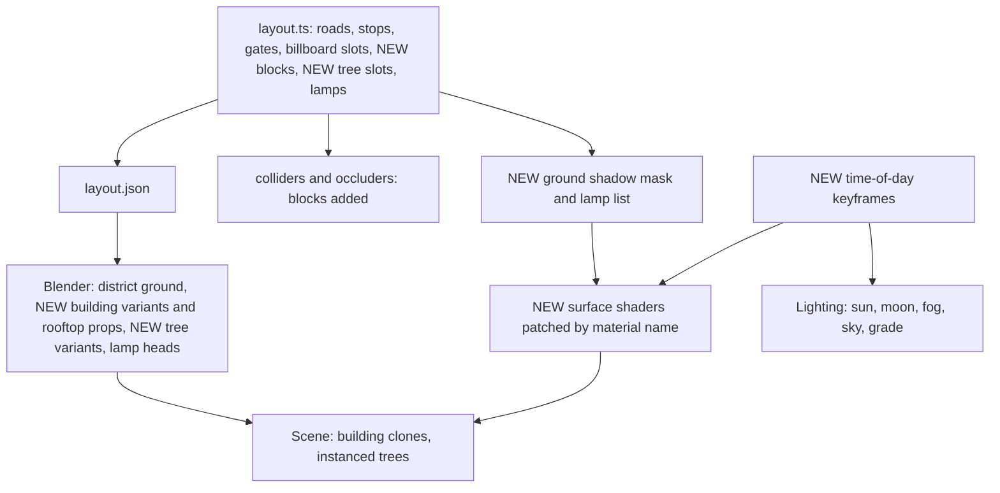

# Golden-Hour Miniature City - Plan

## Goal Capsule

- **Objective:** A visitor driving Apu's portfolio sees a polished, original miniature city: tall varied buildings, rich surfaces, cinematic light at every hour, and a convincing night. The look holds smoothly on an ordinary laptop, and every way of reaching Apu's career content still works as it does today.
- **Means:** Port the approved look-dev into the production scene: runtime surface shaders, new time-of-day keyframes, layout-driven city blocks, and a leaner rendering pipeline (KTD1–KTD11).
- **Product authority:** Apu Islam. The approved look is the look-dev prototype in `.context/compound-engineering/ce-prototype/2026-10-18-golden-hour-city-lookdev/`.
- **Open blockers:** None.
- **Stop conditions:** Stop and ask if the city cannot hold 58 fps on the M1 with per-building dissolve (KTD3), or if blocks cannot fit without moving a stop, gate, or billboard (R1).
- **Who finishes:** `ce-work` implements and verifies locally. Apu drives the result before code review.
- **Product Contract preservation:** Product Contract unchanged.

---

## Product Contract

### Summary

Recompose the district from a park with a thin ring of backdrop buildings into city blocks. A continuous street wall with detailed rooftops lines the existing roads, gates and stops. Carry the approved look-dev across the whole world: its palette, its time-of-day light, and its surface detail. Rebuild the trees, streetlights, ground and pond, and retune rendering so the full look holds 60 fps on an M1 laptop.

### Problem Frame

Screenshots taken on an M1 this session show the district as a flat green tabletop:
- **Space:** at the default zoom, most of the frame is uniform lawn, plaza and wide asphalt. The tall buildings sit at the map's edge, outside the camera's view.
- **Surfaces:** every one is a single flat color. The lighting is flat, sunset looks like noon, and night is a dimmed day in which streetlights light nothing.
- **Assets:** the trees, streetlights and pond read as placeholders.
- **Rendering:** the high tier runs at about 17 fps at retina resolution, so most laptop visitors fall back to a lower tier within seconds and never see the effects meant to make it look good.

A visitor judging Apu's work from this first impression sees a tech demo rather than a crafted experience.

### Key Decisions

- **Recompose the district into a city, not just re-dress it.** Lawns and the outer ring become blocks; roads, stops, gates and physics stay. (session-settled: user-directed — chosen over re-dressing the current layout or densifying only the camera's view: the biggest visual gain.) Governs R1, R2, R3.
- **The golden-hour miniature city look-dev is the target look.** It is a stylized, cartoon-realistic diorama: warm limestone, terracotta and sage buildings, blue-grey asphalt with ochre markings, crisp warm sun against a cool fill, and a moonlit indigo night with sodium-amber pools. (session-settled: user-approved — Apu judged the prototype at midday, golden hour and night: "Looks pretty good.") Governs R5–R11.
- **Assets are procedural, plus a few approved CC0 downloads.** Each download is approved one by one. (session-settled: user-directed — chosen over fully procedural and over allowing CC0 model packs.) Governs R17.
- **Tuned for laptops at 60 fps.** Phones get a lighter version of the same look. (session-settled: user-directed — chosen over desktop-first maximum effects and over one phone-level look for all.) Governs R18, R19.
- **The pond, pitch, Career Tower, robot, Projects Hall and campus keep their places.** Only lawns and the outer ring become city. (session-settled: user-approved — proposed in the scoping summary and confirmed.) Governs R1.
- **Water is a stylized reflective surface, not a full real-time mirror.** It reflects the sky and nearby buildings, with ripples, shore foam, and wet tracks. (session-settled: user-approved — confirmed in the scoping summary; a full mirror exceeds the laptop budget.) Governs R13, R14.
- **Runtime ambient occlusion and the tilt-shift blur are retired.** Baked soft shading and a cleaner image replace them, as in the prototype. (session-settled: user-approved — confirmed in the scoping summary; the blur softens the billboards.) Governs R10, R18.
- **The car stays the new British grand tourer.** It was rebuilt and committed in this session as an original design, not a copy of any maker's car. Only its materials are tuned to the palette. Governs R16.

### Requirements

**City composition**

- R1. The lawns inside the loop and the outer backdrop ring become city blocks. The roads, gates, stops, billboards, pond, football pitch, Career Tower, robot, Projects Hall and campus keep their positions.
- R2. Buildings form a continuous, varied street wall along the roads, in mixed heights and footprints with a few taller towers, so the default camera reads a city and not a park.
- R3. Rooftops carry visible detail (parapets, water tanks, AC units, roof gardens, stair huts), because the high camera sees roofs more than facades.
- R4. Buildings never hide the car or a stop's interaction from the fixed camera without dissolving, as the existing gates and buildings do today.

**Light and time of day**

- R5. Each time of day matches the look-dev's palette and light: crisp midday, warm golden hour with long shadows, a violet blue hour, and a moonlit indigo night.
- R6. At night the ground goes dark and the city lights it: streetlights cast warm pools, windows and storefronts glow warm (with a few cool ones), and section-accent neon signs glow.
- R7. The sky and distance fog follow the time of day, so far blocks fade into the horizon color and the scene has depth.
- R8. The day still follows the visitor's local clock, and the existing time slider still overrides it.

**Surfaces and materials**

- R9. Every large surface shows fine detail at the default zoom: grain and lane wear on asphalt, joints on paving, raised kerbs, and tonal variation on grass.
- R10. Buildings show soft shading where walls meet the ground and in corners, so they sit on the ground rather than floating.
- R11. Building facades show windows with frames and storefronts at street level, reflect the sky by day, and light up at night (R6).

**Hero assets and water**

- R12. Trees are rebuilt as soft, layered canopies in two or three distinct greens, along sidewalks in tree pits and in park pockets.
- R13. The pond reflects the sky and the nearby city, ripples, foams at its shore, and keeps today's splash and wake behavior.
- R14. Driving out of the pond leaves wet tracks that fade, and wet ground looks darker and glossier.
- R15. Streetlights get proper heads with visible bulbs, and they cast the night pools in R6.
- R16. The car keeps its new grand-tourer body. Its paint, glass and chrome read clearly from the high camera at every time of day, and its headlights light the road at night.
- R17. Any CC0 asset (a sky, a tileable texture) is used only after Apu approves that specific download.

**Rendering and performance**

- R18. On an M1 laptop at 1440×900 retina, the full look runs at 60 fps in Chrome, with the resolution scale capped at 1.5.
- R19. Phones and weaker devices get the same palette and lighting with fewer lamp lights, softer bloom, and no shadows on the lowest tier. They never get a different art style.
- R20. The total download stays under the existing 8 MB budget.

**Preservation**

- R21. Driving controls and feel, physics, zones and E prompts, gates, roadside billboards and their captions, the robot, panels, the minimap, fast travel, sound, and the quick view keep working as they do today.

### Acceptance Examples

- AE1. **Covers R6, R8.** Given a visitor whose clock reads 22:00, when the city loads, then the asphalt and grass are dark, lamp pools and lit windows give the light, and the car's headlights light the road ahead.
- AE2. **Covers R13, R14.** Given the car drives through the pond at speed, when it leaves the water, then the surface ripples and splashes as today, and wet tracks trail behind it on the road and fade over several seconds.
- AE3. **Covers R18, R19.** Given an M1 laptop at retina resolution, when the visitor drives for a minute, then the frame rate holds near 60 fps and the quality tier does not drop. Given a phone, the same scene loads in the lighter tier with the same palette.
- AE4. **Covers R4.** Given the car drives behind a tall building as seen from the camera, then that building dissolves around the car, as the Career Tower does today.

### Success Criteria

- Side-by-side screenshots of today's scene and the new one, at the same spots and times, show the city, the surface detail and the night clearly improved. Apu judges them against the approved look-dev.
- A one-minute drive on an M1 in headed Chrome at 1440×900 retina averages at least 58 fps with no tier drop.

### Scope Boundaries

- No new gameplay, interactions, stops, or content. This work is visual.
- No photorealism and no real-time reflection of the whole scene in the water.
- No changes to roads, stop positions, collider behavior, or driving tuning.
- No CC0 model packs. Only individually approved skies or textures (R17).
- Deferred for later: traffic, pedestrians, weather, and seasonal variation.

### Outstanding Questions

**Deferred to Planning**

- How the soft shading is produced (baked in Blender, vertex colors, or shader-side), as long as R10 holds within R18.
- How the new blocks are laid out around the stops while keeping the tour order and the billboard clearances that today's layout tests enforce.
- Whether the Career Tower, Projects Hall and campus need material updates to match the new palette, or only lighting.
- The exact lighter-tier recipe for phones (R19), measured on a real device.

### Sources

- Look-dev prototype: `.context/compound-engineering/ce-prototype/2026-10-18-golden-hour-city-lookdev/01-art-direction/screens/` (`scene.js` holds the palette, the time-of-day keyframes, and the shaders for grass, asphalt, paving and walls). Run notes are in `decisions.md` beside it.
- Current pipeline: `src/world/lighting/` (Lighting, timeOfDay keyframes, PostFx, quality tiers), `src/world/scene/Water.tsx`, `assets/blender/models/` (`district.py`, `buildings.py`, `props.py`).
- Measured this session in Chrome on the M1 GPU at 1440×900: today's high tier at about 17–19 fps at resolution scale 2; the prototype at about 40–47 fps at 1.5 in headless Chrome. Headless runs read lower than headed Chrome.

---

## Planning Contract

### Key Technical Decisions

- KTD1. **Surface detail is added by shaders at runtime, patched onto the models' materials by name.** The grass, asphalt, paving, kerb and wall shaders port from the look-dev's `scene.js`, and Blender keeps exporting plain named materials. Nothing new to download, and the look stays tunable in code. (session-settled: user-approved — confirmed in the plan scoping summary over painted textures.) Governs R9, R11.
- KTD11. **Shader patches compose.** The surface patch and the existing dissolve patch each wrap whatever `onBeforeCompile` a material already has, and append their own part to its program cache key. Today's dissolve patch replaces the hook and fixes the key to `ce-dissolve`, and `Material.clone()` drops an instance-level hook, so the two would otherwise cancel each other. Building walls are patched after `makeDissolvable` copies them, so each copy carries its own building's uniforms (origin, size, top, seed, palette). Governs R4, R11.
- KTD2. **City blocks are layout data.** `src/world/district/layout.ts` gains block placements (footprint, height, palette, facing). Colliders, occluders, trees, lamps, the minimap and the Blender build read them, as they read every other placement. A layout test enforces their clearances. Governs R1, R2.
- KTD3. **Each building is its own object (a clone of a variant), not batched,** so the existing per-object dissolve keeps working (R4). Variants are built in Blender at the origin, with storefront, cornice, parapet and rooftop props. The window grid is drawn by the wall shader in each building's own frame, so one variant serves many heights. (session-settled: user-approved — confirmed in the plan scoping summary: per-building dissolve over batched rendering.) Governs R2, R3, R4, R11.
- KTD4. **Height follows the camera.** High-rises stand north and east of the loop (the far side). A row fronting a road on its south or west side (the camera side) is capped at 9 m including its parapet. From the camera's 48° angle, a frontage at the back of a 3 m sidewalk hides a car on the near lane only above about 9 m. Other inner-loop blocks next to roads stay mid-rise, so the car is rarely hidden at all. (session-settled: user-approved — confirmed in the plan scoping summary.) Governs R2, R4.
- KTD5. **Lamp pools are painted by the ground shaders from a list of lamp positions, not lit by real lights.** Every lamp glows on every tier, and the car's two headlight spots remain the only real night lights. (session-settled: user-approved — confirmed in the plan scoping summary.) Governs R6, R15, R19.
- KTD6. **Ground contact shading comes from a soft shadow mask drawn at load from the building footprints in the layout,** sampled by the ground shaders. The wall shader darkens wall bases, as in the look-dev. Nothing is baked in Blender, so moving a block never needs a rebuild. This is the soft shading the Product Contract's Key Decision calls baked: it is drawn once at load, not computed every frame. The mask also covers the landmarks (Career Tower, Projects Hall, campus, gate pillars, kiosk), which lose N8AO. (session-settled: user-approved — confirmed in the plan scoping summary.) Governs R10.
- KTD7. **The pond reflects a cube snapshot of its surroundings,** taken at load and refreshed when the time of day moves by more than about half an hour, blended into the existing ripple shader with a shore-foam band. Wet tracks gain gloss. (session-settled: user-approved — confirmed in the plan scoping summary over per-frame reflection.) Governs R13, R14.
- KTD8. **Lighting adopts the look-dev's keyframes and grade.** Sun azimuth, elevation and color; hemisphere fill; exponential fog; exposure; and a moon hand-off at night. The reflection environment becomes a capture of the time-of-day sky shader (a PMREM), refreshed when the hour moves more than 0.2 h, in place of today's fixed studio panels, so glass and paint reflect the hour. The post-processing drops N8AO and tilt-shift, keeps bloom, and adds a vignette, a slight contrast and saturation grade, and ACES tone mapping. Governs R5, R7, R11, R16, R18.
- KTD9. **Trees move from random scatter to deliberate placement:** street trees in pits along the sidewalks, plus clusters in the park pockets. They become instanced layered canopies in three greens. (session-settled: user-approved — confirmed in the plan scoping summary.) Governs R12.
- KTD10. **Quality tiers keep the same art direction.**
  - High: shadows at 2048, bloom, resolution scale capped at 1.5.
  - Medium: shadows at 1024, bloom, resolution scale 1.25.
  - Low: no shadows, a softer half-resolution bloom, resolution scale 1.

  Every tier keeps the grade, vignette and tone mapping. Lamp pools and lit windows are shader-only, so they survive every tier. The 60 fps target in R18 passes at an average of at least 58 fps over a one-minute run. Governs R18, R19.

### High-Level Technical Design

The layout drives every consumer. New data and modules are marked.

### Assumptions

- Every frame-rate gate is a headed run. The first headed baseline (after U2, at night, 1440×900 retina, resolution scale 1.5): 58.8 and 60.0 fps averages, 5th percentile about 54 fps, no tier drop.

### Implementation Units

### U1. Time-of-day lighting from the look-dev

- **Goal:** Replace the lighting keyframes and sky with the look-dev's, including the moon hand-off and stars.
- **Requirements:** R5, R7, R8 (KTD8).
- **Dependencies:** None.
- **Files:** `src/world/lighting/timeOfDay.ts`, `src/world/lighting/timeOfDay.test.ts`, `src/world/lighting/Lighting.tsx`, `src/world/lighting/state.ts`.
- **Approach:**
  1. Port the look-dev `KEYS` (hour, sun azimuth and elevation, colors, hemisphere, fog density, environment, night, exposure) into `timeOfDay.ts`, keeping `lightingAt(hours)` as the one pure entry point.
  2. Switch the fog to exponential.
  3. Add stars and a sun glow to the sky shader.
  4. Add overnight keys at 0:00 and 4:30 that hold the 23:30 moonlit look (night 1), so the night lasts until the 6:00 dawn key.
  5. Interpolate sun azimuth along the shortest arc.
  6. Blend the key light from sun to moon over night 0.5–0.7, as today's `sunDirection` does, rather than switching.
  7. Replace the fixed Lightformer environment with the sky PMREM (KTD8).
- **Patterns to follow:** The existing keyframe blend in `timeOfDay.ts`, and `applyTime` in the look-dev `scene.js`.
- **Test scenarios:**
  - At 18:12 the sun sits low (elevation under 15°) and in the west-south-west, and its color is warmer than at 13:00.
  - At 22:00 night is 1, the key light comes from the moon's direction, and the hemisphere fill is bright enough that the ground isn't black (intensity at least 0.6).
  - Blending is continuous across midnight and across each keyframe boundary: no jump larger than a small epsilon between adjacent minutes, in color and in key-light direction.
  - At 00:30, 03:00 and 04:30, night is at least 0.95 and the key light comes from the moon.
  - The environment refreshes when the hour moves more than 0.2 and not on smaller moves.
- **Verification:** Screenshots at 13:00, 18:12 and 22:00 match the look-dev's palette and light.

### U2. Leaner rendering pipeline and tiers

- **Goal:** Drop N8AO and tilt-shift, add the grade, and cap the resolution scale per tier.
- **Requirements:** R18, R19 (KTD8, KTD10).
- **Dependencies:** None.
- **Files:** `src/world/lighting/PostFx.tsx`, `src/world/lighting/quality.ts`, `src/world/lighting/quality.test.ts`, `src/world/World3D.tsx`, `scripts/measure-fps.mjs` (new).
- **Approach:**
  1. Use the KTD10 tier table. Every tier runs the composer, so the grade holds everywhere. The low tier's bloom runs at half resolution.
  2. Add the headed-Chrome frame-rate script: a one-minute drive on the M1 at 1440×900 retina, reporting the average fps and any tier drop.
  3. Run it on today's scene with this unit's changes, and record the result as the headed baseline.
- **Patterns to follow:** The existing `TIER_SETTINGS` and `PostFx`.
- **Test scenarios:**
  - Each tier's resolution scale is capped at 1.5, 1.25 and 1.
  - Bloom is on for every tier, at half resolution on low. The grade and tone mapping are on for every tier.
  - The tier choice for touch devices, low memory, and software rendering is unchanged.
- **Verification:** On the M1 the scene renders with no ambient occlusion or blur pass, and the headed baseline is recorded in the plan's Sources.

### U3. Surface shaders patched by material name

- **Goal:** Give grass, asphalt, paving, kerbs, plazas and walls the look-dev's per-pixel detail, with lamp pools and ground contact shading.
- **Requirements:** R6, R9, R10, R11, R15 (KTD1, KTD5, KTD6).
- **Dependencies:** U1 (night level).
- **Files:**
  - `src/world/lighting/surfaceShaders.ts` (new)
  - `src/world/lighting/surfaceShaders.test.ts` (new)
  - `src/world/lighting/groundMask.ts` (new)
  - `src/world/lighting/groundMask.test.ts` (new)
  - `src/world/scene/District.tsx`
  - `assets/blender/models/district.py` (material names only, if a surface lacks its own)
- **Approach:**
  1. Map each glTF material name to a shader kind (grass, asphalt, paving, kerb, wall, roof), and patch its standard material once, composing with any existing patch (KTD11) and sharing a night uniform.
  2. Asphalt finds its lane from the distance to the road centre line: the loop's rounded-rectangle signed distance (mirroring `onRoad()`, with the loop's size passed in) and the cross street's distance. One `asphalt` material then covers straights, corners and the cross street.
  3. Pass the lamp positions to ground shaders as a uniform array (at most 48). Each pixel adds a warm, distance-faded pool scaled by night.
  4. Draw the ground mask at load: building and landmark footprints rasterized into a small grayscale texture and blurred, then sampled by the ground shaders.
- **Execution note:** Start with failing tests for the material-to-kind mapping and the footprint mask before writing shaders.
- **Patterns to follow:** `shaded()` and `FRAGMENTS` in the look-dev `scene.js`, and how `makeDissolvable` patches materials idempotently.
- **Test scenarios:**
  - Each district material name maps to its kind, and an unknown name is left untouched.
  - Patching the same material twice (StrictMode) changes it once.
  - A wall material patched for both the surface and the dissolve compiles with both the dissolve discard and the window grid, and its program cache key differs from a dissolve-only material's.
  - The asphalt lane coordinate is 0 on the loop's centre line on a straight and on a corner, and on the cross street's centre line.
  - The footprint mask is dark under a building and at the Career Tower's and Projects Hall's edges, fades to clear within about 3 m outside them, and is clear on open road.
  - The lamp list holds every layout lamp and stays within the uniform cap.
- **Verification:** Screenshots show asphalt grain, paving joints, kerbs, mottled grass, and lamp pools at night.

### U4. City blocks in the layout

- **Goal:** Add city blocks around the existing roads, gates and stops, with colliders, occluders, and tree and lamp clearances.
- **Requirements:** R1, R2, R4 (KTD2, KTD4).
- **Dependencies:** None.
- **Files:** `src/world/district/layout.ts`, `src/world/district/colliders.ts`, `src/world/district/occluders.ts`, `src/world/district/layout.test.ts`, `src/world/district/occluders.test.ts`, `src/world/scene/District.tsx` (places the blocks with today's four variants until U5).
- **Approach:**
  1. Define block zones: the outer ring outside the loop, and the inner lawns not taken by the pond, pitch, campus, plazas, tower forecourt or billboard slots. Also reserve park pockets (around the pond, the benches and the flower beds) that U6 fills with trees.
  2. Fill each zone with buildings fronting the nearest road, from a seeded generator, applying the KTD4 height caps.
  3. Replace `BUILDINGS` with the blocks. Colliders and occluders follow every building.
- **Patterns to follow:** `ROADSIDE_SLOTS` and the clearance tests from the section-roads work, and the `BUILDINGS` generator.
- **Test scenarios:**
  - No building overlaps a road or sidewalk, a plaza, the pond, the pitch, a park pocket, a physics prop, a flower bed, a stop, a gate, a billboard slot, the Career Tower, the hall or the campus.
  - High-rises stand only north or east of the loop.
  - With the camera at default zoom following a car along every lane, `blockingOccluders` never returns a camera-side block (KTD4).
  - Every building has a collider and an occluder that encloses it.
  - The start stays clear, the tour order holds, and every zone and parking spot stays clear of solids.
- **Verification:** Layout tests pass. A top-down capture shows streets lined by buildings rather than lawn.

### U5. Building variants and rooftops

- **Goal:** Model building variants and rooftop props, and place a clone of each at its block.
- **Requirements:** R2, R3, R4, R11 (KTD3).
- **Dependencies:** U3 (wall shader), U4.
- **Files:** `assets/blender/models/buildings.py`, `public/models/buildings.glb`, `src/world/scene/District.tsx`, `src/world/district/assets.test.ts`.
- **Approach:**
  1. Build six to eight footprint variants at the origin, each from three named parts:
     - a base: plinth, storefront band with awnings, and brass line
     - a unit-height shaft: the wall box
     - a crown: cornice, parapet, and two or three rooftop props (water tank, AC units, roof garden, stair hut, skylight)
  2. Walls use a named wall material, which U3 patches with the window grid, lit windows and base shading. No window geometry. The shader counts floors from world height above the base.
  3. Section-accent neon signs (blade signs and storefront strips) go on storefronts near each section's road, glowing at night (R6).
  4. The runtime clones each building at its block, stretching only the shaft in height and lifting the crown onto it, so the base and crown keep their modeled sizes. It registers the dissolve, then patches the walls (KTD11).
  5. Run the headed frame-rate script with every block placed, and stop per the Goal Capsule if it falls below the floor.
- **Patterns to follow:** `rooftop()` and `building()` in the look-dev `scene.js`, and the backdrop clones in `District.tsx`.
- **Test scenarios:**
  - `buildings.glb` has every variant's base, shaft and crown nodes and the wall, roof and rooftop material names.
  - Each variant's footprint fits its layout footprint within 0.5 m.
  - At two different block heights, the storefront band and rooftop props keep their modeled heights.
  - Neon sign materials glow at night and stay dim by day.
- **Verification:** At 13:00 and 22:00, captures show varied facades, roofs with props, and lit windows at night.

### U6. Trees and streetlights

- **Goal:** Replace scattered blob trees with instanced layered canopies in deliberate places, and give lamps proper heads.
- **Requirements:** R12, R15 (KTD9).
- **Dependencies:** U4.
- **Files:** `src/world/district/layout.ts` (tree slots), `src/world/district/layout.test.ts`, `assets/blender/models/district.py`, `assets/blender/models/props.py` (tree variants), `public/models/district.glb`, `public/models/props.glb`, `src/world/scene/District.tsx`.
- **Approach:**
  1. `TREES` becomes street-tree pits along the sidewalks (between lamps, clear of billboards and gates) plus clusters in the park pockets.
  2. Make three canopy variants with gradient vertex colors, instanced at runtime.
  3. Lamp heads get a visible bulb with the `street_lamp` material.
- **Patterns to follow:** `tree()` and `canopyGeometry()` in the look-dev, and the current `TREES` clearance rules.
- **Test scenarios:**
  - Street trees sit in sidewalk pits, never on the road, a billboard slot or a gate.
  - Park clusters stay off the pond, the pitch, plazas and paths.
  - Every tree keeps a trunk collider.
- **Verification:** Captures show tree-lined streets, with lamp heads that glow at night.

### U7. Pond reflections and wet surfaces

- **Goal:** Make the pond reflect the city and sky, with shore foam and glossy wet tracks.
- **Requirements:** R13, R14 (KTD7).
- **Dependencies:** U1.
- **Files:** `src/world/scene/Water.tsx`, `src/world/scene/waterReflection.ts` (new), `src/world/scene/waterReflection.test.ts` (new).
- **Approach:**
  1. A small cube camera at the pond's center renders the surroundings once after load, and again when the time of day moves by more than 0.5 h.
  2. The water shader samples it along the ripple-perturbed reflection vector, mixed by fresnel.
  3. A foam band follows the shore depth.
  4. Track prints change from a multiply-blended unlit material to a transparent standard material (dark tint, low roughness, alpha fading with age), so they both darken the road and catch highlights.
- **Patterns to follow:** The existing ripple uniforms and track pool in `Water.tsx`.
- **Test scenarios:**
  - The reflection refreshes when the hour moves by more than 0.5 and not on smaller changes, including across midnight.
  - The existing splash and wet-track behavior is unchanged.
- **Verification:** At golden hour a capture shows buildings and sky in the pond, foam at the edge, and glossy wet tracks after a pass.

### U8. Car and landmark materials, and verification

- **Goal:** Tune the car's and landmarks' materials to the palette, prove 60 fps, and update the docs.
- **Requirements:** R16, R18, R20, R21, Success Criteria.
- **Dependencies:** U1–U7.
- **Files:** `assets/blender/models/car.py` (material values only), `assets/blender/models/career_tower.py`, `assets/blender/models/landmarks.py` (palette only), `public/models/*.glb`, `e2e/smoke.spec.ts`, `README.md`.
- **Approach:**
  1. Adjust paint, glass and trim values only where captures show a clash.
  2. Run the U2 frame-rate script on the finished city.
  3. Load the build on a real phone, or at the lowest tier in headed Chrome if no phone is at hand. Record the tier and frame rate, and capture it beside the laptop at 18:12 and 22:00. Raise any conflict with the low-tier recipe with Apu.
  4. Keep the existing browser tests passing, and update the README's art notes.
- **Execution note:** This unit is mostly measurement. Prefer captures and the frame-rate run over new unit tests.
- **Test scenarios:**
  - The full browser suite passes with the new city: the Career drive, pond, cones, footballs, billboards, robot, Projects Hall, map, and fast travel.
  - The frame-rate script reports an average of at least 58 fps and no tier drop on the M1.
- **Verification:** The budget passes, and before/after captures at the same spots and times go to Apu.

---

## Verification Contract

| Gate | Command | Proves |
| --- | --- | --- |
| Types | `npm run typecheck` | No stale references |
| Unit | `npm test` | Keyframes, tiers, shader mapping, ground mask, layout clearances, reflection refresh (U1–U7) |
| Models | `npm run assets:build -- buildings district props` (and `car career_tower landmarks` when touched) | Variants build, asset tests find every node |
| Browser | `npm run test:e2e` | Every existing drive and interaction still works (R21) |
| Budget | `npm run build`, then `npm run budget` | Under 8 MB (R20) |
| Frame rate | `node scripts/measure-fps.mjs` in headed Chrome on the M1, after U2, after U5, and at the end | 60 fps target, at least 58 fps average, no tier drop (R18) |
| Phone | Real phone, or lowest tier in headed Chrome | The low tier loads with the same palette and records its frame rate (R19, AE3) |
| Visual | Captures at 13:00, 18:12 and 22:00 from fixed spots, before and after | Success Criteria, judged by Apu |

## Definition of Done

- Every requirement holds and every gate passes, the frame-rate run included.
- N8AO and tilt-shift are gone from the code. No scattered-tree or old backdrop-ring generator remains.
- Dead code from abandoned attempts is removed.
- Each unit lands as its own path-limited commit.
- Apu has seen the before/after captures and driven the result before code review.

