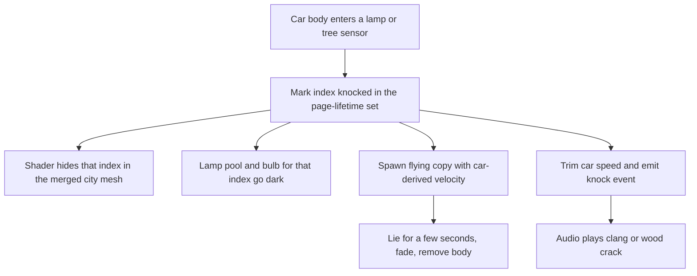
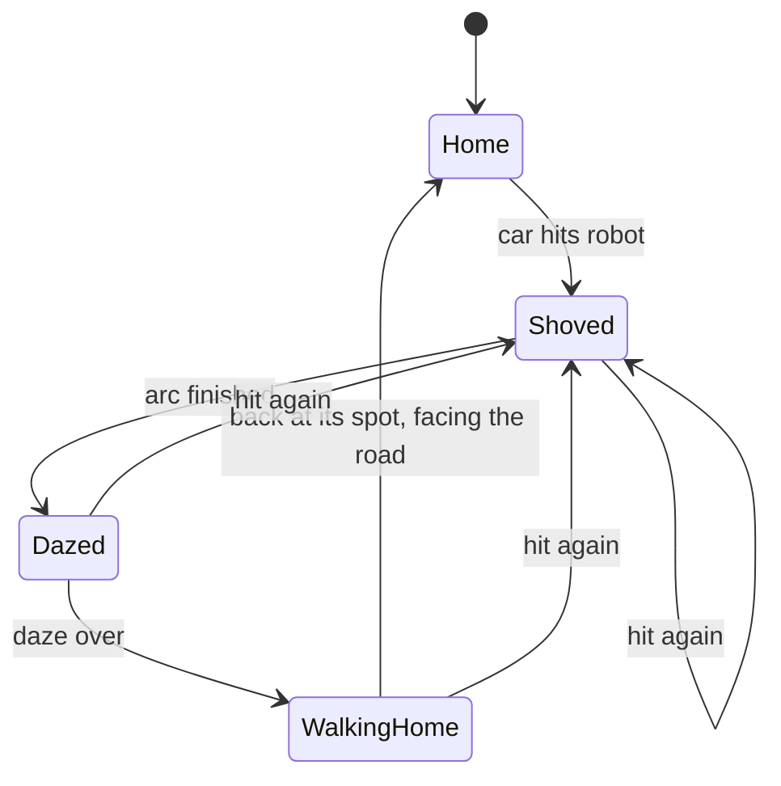

# Knock-Over Scenery, Robot Bump and Nitro Boost - Plan

## Goal Capsule

- **Objective:** Driving through the city feels playful: lamp posts and trees go flying instead of stopping the car, the SeCAREly robot reacts to a bump with a joke and recovers, and the driver can fire a short nitro boost.
- **Means:** lamps and trees stay drawn as part of the city model but can be hidden one at a time, the car passes through them and knocks loose a flying copy (KTD1, KTD2). The robot reacts through a scripted stumble (KTD4). The boost is a tank-limited multiplier on the car's engine (KTD5).
- **Product authority:** Apu Islam (portfolio owner). All four items are in this plan as one unit. The Product Contract wins over the Planning Contract when they disagree.
- **Open blockers:** U1 and U2 are blocked until the golden-hour city overhaul (`docs/plans/2026-10-19-0145-feat-golden-hour-city-plan.md`) lands its remaining building and polish units, because both rebuild the district model. U3 and U4 can start now.
- **Stop conditions:** stop and ask if the frame-rate gate (R17) fails after U2 or U5, or if hiding single objects inside the merged city model proves impossible through the asset pipeline (see Risks).
- **Execution profile:** units land one at a time with their tests. Apu test-drives each build before code review runs.

---

## Product Contract

### Summary

Lamp posts and trees become knock-over scenery that stays gone until the page reloads, each hit with its own impact sound. The SeCAREly robot gets bumped aside, says a friendly, funny line in its speech bubble with robot chirps, and walks back to its spot. Holding Shift fires a nitro boost from a small refilling tank, with a flame from the car's exhausts and a HUD gauge.

### Problem Frame

Lamp posts, tree trunks and the robot are solid today, so a casual swerve into one stops the car dead. In a portfolio built around driving for fun, that reads as the world getting in the way. Cones, crates and the brick wall already scatter and make crash sounds, so the stiff lamps and trees feel inconsistent next to them. The car also has no way to burst forward, which leaves the drive without a moment of excitement.

### Key Decisions

- **One plan for all four items.** They share the car's crash handling and the crash sound set, and the owner will test-drive them together. (session-settled: user-approved — chosen over scoping knock-overs or the boost alone first: shared crash physics and sounds, one test drive.)
- **The robot recovers instead of disappearing.** It is a career stop, so it has to stay reachable. Governs R7, R9. (session-settled: user-approved — chosen over staying where it lands or vanishing until reload: either option breaks or relocates the SeCAREly stop.)
- **The robot speaks in its existing speech bubble, with robot chirps.** It works in every browser and reads with sound off. Governs R8. (session-settled: user-approved — chosen over browser text-to-speech, whose voices vary by device and are missing in some browsers, and over a bubble with no sound.)
- **The boost is limited by a small tank that refills.** Short bursts feel special and keep the city readable at speed. Governs R12, R13. (session-settled: user-approved — chosen over unlimited boost and over a one-tap burst with a cooldown.)
- **The boost raises top speed by roughly a third.** That keeps the fixed follow camera and the crashes readable. Governs R11.
- **Trees follow the lamp rule.** Both stay gone until reload, unlike cones and crates, which tidy back into place. Governs R1, R4.

### Requirements

**Knock-over lamp posts and trees**

- R1. When the car hits a lamp post or a tree, that object is knocked loose and tumbles away from the impact. It stays gone until the page reloads or a new session starts.
- R2. Knocking an object over slows the car only slightly. The car keeps driving rather than stopping dead.
- R3. A knocked object lies where it lands for a few seconds, then fades out, and its original spot stays empty.
- R4. Every lamp post and tree in the city is knockable, including the street trees and the park clusters.
- R5. A lamp post hit plays a metallic clang. A tree hit plays a wood crack. Both are louder for faster impacts.
- R6. At night, a knocked lamp's bulb and its light pool on the ground go dark along with it.

**SeCAREly robot bump**

- R7. When the car hits the robot, it is shoved a few metres from the impact and stumbles. After a few seconds it walks back to its home spot and faces the road again.
- R8. On each hit, the robot shows one line in its speech bubble, accompanied by a short robot-chirp sound. The line comes from a rotating set of four or five friendly, funny lines about not being a threat, for example "Ow! I'm a robot, not a speed bump!" and "Relax, AI isn't taking your job. I'm just here to help!"
- R9. The SeCAREly career stop keeps working: once the robot is home, pressing E in its zone opens the SeCAREly project as before.
- R10. A short cooldown stops repeated ramming from spamming lines. A hit during the cooldown still shoves the robot but shows no new line.

**Nitro boost**

- R11. Holding Shift while driving forward gives a burst of extra acceleration and roughly a third more top speed.
- R12. The boost draws from a tank holding about 3 seconds of boost. The tank refills over a few seconds once the boost is released, and an empty tank stops the boost until some has refilled.
- R13. A small HUD gauge shows how full the tank is.
- R14. While boosting, a nitro flame shoots from the car's exhausts with a whoosh sound. Both stop when the boost ends.
- R15. Phones and tablets get a boost button next to the existing touch controls that behaves like holding Shift.

**Everything else stays as it is**

- R16. Driving controls, physics feel, career stops and interactions are otherwise unchanged. Cones, crates and the brick wall keep their current behavior, including tidying back into place.
- R17. The city still holds the frame-rate targets of the golden-hour city plan with knocked objects in motion and the boost flame showing.

### Acceptance Examples

- AE1. **Covers R1, R3.** Given a lamp post was knocked over, when the car drives back past its spot a minute later, the spot is empty. After a page reload, the lamp post stands there again.
- AE2. **Covers R2, R5.** Given the car is at cruising speed, when it clips a tree, the tree topples with a wood crack and the car carries on with only a small loss of speed.
- AE3. **Covers R7, R8, R9.** Given the car bumps the robot, when it stops nearby, the robot shows a line with chirps, walks home within a few seconds, and driving into its zone and pressing E opens the SeCAREly project.
- AE4. **Covers R10.** Given the robot was hit two seconds ago, when the car hits it again, it is shoved again but no new line appears.
- AE5. **Covers R12, R13.** Given the tank is full, when Shift is held for longer than about 3 seconds, the boost and flame stop and the gauge shows empty. After Shift is released, the gauge refills over a few seconds.
- AE6. **Covers R6.** Given it is night, when a lamp post is knocked over, its pool of light on the road disappears at once.

### Scope Boundaries

- Knocked lamps and trees do not come back during a session. They return only on reload or in a new session.
- No other scenery becomes breakable in this work: buildings, gates, billboards and landmarks stay solid.
- No scoring, counters or achievements for knocking things over.
- No spoken text-to-speech voice for the robot.
- No boost while reversing, and no change to the car's handling apart from the boost.

### Dependencies / Assumptions

- This work follows the golden-hour city overhaul, which reworks the lamps (heads with bulbs, night light pools) and the trees (street trees in pits, park clusters). The current layout has 25 street trees and 16 park trees.
- Lamp posts and tree trunks are fixed colliders today (`src/world/district/colliders.ts`), and the robot is a solid cylinder in the road on purpose. Lamps and trees are also baked into the district model (`assets/blender/models/district.py`), so they need to become individual movable objects.
- The robot already has a greeting speech bubble (`src/world/scene/Landmarks.tsx`, `src/world/scene/robotMotion.ts`), and the crash sound set already has a wood material and a crack layer (`src/world/audio/synth.ts`).
- Cones, crates and bricks are already physical, wake when hit and tidy themselves up later (`src/world/scene/Props.tsx`), which is a reference for the knock-over behavior.

### Outstanding Questions

**Deferred to Implementation**

- Final throw strength, spin and lie-before-fade time for knocked lamps and trees, tuned in a test drive from the starting values in KTD3.
- Final boost numbers, tuned in a test drive from the starting values in KTD5.

The reduced-motion question is resolved in KTD7.

---

## Planning Contract

Product Contract preservation: restructured, no scope change. Requirement IDs were renumbered once before planning (the robot cooldown is R10, the boost is R11–R15, the guard rails are R16–R17) and every citation points at the new IDs. The reduced-motion question moved from the Product Contract to KTD7.

### Key Technical Decisions

- KTD1. **Lamps and trees stay merged in the city model; each one can be hidden on its own.** The Blender build tags every vertex of a lamp or tree with its index, and a shader patch on those merged meshes collapses the vertices of knocked indices. This keeps today's draw-call count and the exact look from the golden-hour work, instead of 40+ extra meshes or swapping the randomised canopies for three shared prototypes. The flying copy is cut from the merged geometry by that same index when a knock happens. Governs R1, R3, R4, R6, R17.
- KTD2. **The car drives through lamps and trees; it never bounces off them.** Their fixed colliders become sensors. When the car's body enters one, the scene marks it knocked, spawns the flying copy with a velocity taken from the car, and trims the car's speed by a small fixed share. A solid collider would stop or deflect the car before any knock logic ran, which breaks R2. Governs R1, R2.
- KTD3. **Knocks are throws, not simulated breakage.** The flying copy is one dynamic body with a simple collider (a capsule for lamps, a trunk cylinder for trees), thrown along the car's heading with an upward kick and a tumble. Starting values: horizontal speed about 0.8 × car speed plus 2 m/s, upward 3–4 m/s, car speed loss 8 % for lamps and 12 % for trees, lie time 4 s, fade 1 s. The body is removed after the fade.
- KTD4. **The robot's reaction is a scripted state machine, not free physics.** States: home, shoved (about 0.6 s arc up to 3 m from the impact, with a tilt), dazed (about 1.5 s), walking home (about 1.2 m/s, turning to face the road at the end). A kinematic sensor follows it so it can be bumped again in any state. The shove path is clipped so the robot never ends inside a building, a static collider or the pond. A contact counts as a hit only when the car closes on the robot faster than about 2 m/s, and while walking home the robot waits in place if the car sits on its path or its spot, so a parked car can't trap it in a loop of shoves. Governs R7, R9, R10. Its lines and cooldown follow the user-approved bubble-and-chirps decision (Governs R8).
- KTD5. **The boost scales engine force and top speed while a tank lasts.** Starting values: engine force × 1.6 and top speed × 1.33 (26 → about 35 m/s). The tank holds 3 s, starts refilling 0.4 s after release, and refills fully in 2.5 s. An empty tank re-arms at 20 %. The tank is pure state, ticked in the car's physics step and published through telemetry for the HUD, the flame and the audio. Instantiates the user-approved limited-tank decision (Governs R11, R12).
- KTD6. **Knocked state lives for the page's lifetime in a module, not in React state.** Leaving the city for the quick view unmounts the Canvas. Component state would be lost on the way back, and the Contact-kiosk bug fixed in `src/world/scene/District.tsx` showed that cached models outlive a mount. A module-level set of knocked lamp and tree indices survives remounts and clears only on reload. Governs R1.
- KTD7. **Reduced motion keeps every behavior and softens the motion.** With reduced motion on, the robot slides to its spot and back without tilting or bobbing, knocked lamps and trees fade where they stand instead of being thrown, and the nitro flame holds a steady shape instead of flickering. This matches how `src/world/scene/robotMotion.ts` already holds the robot still under reduced motion.
- KTD8. **New sounds go through the existing event bus and synth, not samples.** Knocks emit a dedicated knock event carrying the kind (lamp or tree), intensity and position. The audio engine plays a metal clang with a long ring for lamps, and the existing wood knock plus crack layer with a creak tail for trees. The robot hit plays a short chirp phrase, and the boost plays a looping hiss with the existing whoosh on start. This follows the audio rule at the top of `src/world/audio/AudioEngine.ts`: physics publishes, audio subscribes.

### High-Level Technical Design

How a knock flows from contact to the empty spot:

The robot's reaction (KTD4):

A line shows on a hit only when the last line is more than the cooldown old (R10). The bubble's greeting returns once the line has shown for about 3 s.

### Assumptions

- The golden-hour overhaul's remaining units change `assets/blender/models/district.py` and `src/world/district/layout.ts` but keep LAMPS and TREES as indexed lists, so the index tagging in KTD1 still applies after they land.
- glTF export carries an underscore-named custom vertex attribute through `gltf-transform optimize`, which already runs with pruning off (see Risks).

### Sequencing

U1 → U2 for the knock-overs. U3 is independent. U4 → U5 for the boost. U6 runs last. U1 and U2 wait for the golden-hour overhaul's district changes.

### Risks & Dependencies

| Risk | Mitigation |
|---|---|
| Blender's glTF export drops custom vertex attributes unless they are named with a leading underscore and `export_attributes` is on. (`scripts/build-assets.mjs` already runs optimize with `--prune false`.) | Name the attribute `_OBJ_INDEX` (point domain) and turn on `export_attributes` in `assets/blender/lib/kit.py`. A unit test loads `public/models/district.glb` and finds the attribute on the lamp and tree meshes. If it still can't be kept, stop and ask (Goal Capsule stop condition) rather than switching to per-object meshes. |
| Parts left untagged default to index 0 after the join and would hide along with lamp 0. | Index spaces start at 1, and the attribute test fails on any lamp or tree vertex with index 0. |
| Sensors fire on any body, so a thrown cone or football could knock a lamp. | Only the car's chassis body counts as a hit. |
| Many flying bodies at once could cost frame time. | Each copy lives about 5 s, and a cap of 8 live copies removes the oldest early. Measured in the U6 frame-rate gate. |
| The boost makes the car outrun the follow camera. | Top speed rises by a third only (KTD5). Checked in the test drive. |

---

## Implementation Units

### U1. Hideable lamps and trees in the city model

**Goal:** every lamp and tree in the merged city meshes can be hidden by index, with its night light pool and bulb going dark, and knocked state lasts for the page's lifetime.

**Requirements:** R1, R3, R4, R6, R17. KTD1, KTD6.

**Dependencies:** the golden-hour overhaul's district changes.

**Files:**
- `assets/blender/models/district.py`
- `assets/blender/lib/kit.py`
- `scripts/build-assets.mjs`
- `public/models/district.glb`
- `src/world/scene/breakables.ts` (new)
- `src/world/scene/breakables.test.ts` (new)
- `src/world/lighting/surfaceShaders.ts`
- `src/world/lighting/surfaceShaders.test.ts`
- `src/world/scene/District.tsx`

**Approach:**
1. In `district.py`, write a per-vertex object index on every part of each lamp (pole, base, arm, housing, head) and each tree (pit, trunk, underside, canopy clumps) before the meshes are joined. Keep lamps and trees in separate index spaces, for example by offsetting tree indices.
2. Name the attribute `_OBJ_INDEX` and turn on `export_attributes` in the glTF export, so the attribute reaches `public/models/district.glb`. Index spaces start at 1, so 0 means untagged.
3. `breakables.ts` holds the page-lifetime knocked set, a change counter, and lookups from index to layout record.
4. A shader patch through `addShaderPatch` on the lamp and tree materials reads knocked flags from a small data texture and collapses knocked vertices. Each lamp and tree mesh also gets a `customDepthMaterial` carrying the same patch, because the shadow pass never runs the colour material's patch and a knocked object would otherwise still cast its shadow.
5. `lampList` and `installLamps` skip knocked lamps so their pools go dark. The bulb's night glow goes with the hidden head.
6. `District.tsx` installs the patch. When the change counter moves, it refreshes the flags texture and calls `installLamps` again, because the pool uniforms are otherwise loaded only once at mount.

**Patterns to follow:** `src/world/scene/shaderPatch.ts` for composing with the dissolve and surface patches. `src/world/lighting/groundMask.ts` for a small data texture fed to shaders. The `kiosk_contact` caching in `src/world/scene/District.tsx` as the reason state outlives a mount.

**Test scenarios:**
- Marking lamp 3 knocked shows up in the set, and knocking it again does not bump the change counter twice.
- The knocked set survives a simulated unmount and remount of the scene (module state, not component state).
- With lamp 3 knocked, `lampList` returns one fewer lamp and none at lamp 3's head position, and after `installLamps` runs again the lamp-count uniform is one lower.
- The lamp and tree meshes carry a patched depth material, so knocked objects drop out of the shadow pass too.
- The lamp and tree materials compile with the hide patch, the dissolve patch and the surface patch together, and each combination gets its own program cache key.
- Loading the built `public/models/district.glb` finds the object-index attribute on the lamp and tree meshes, with one distinct index per LAMPS and TREES entry and no vertex left at index 0.

**Verification:** with a lamp and a tree marked knocked from the console, both vanish from the scene along with their shadows at noon, and at night the lamp's pool is gone. Every other lamp and tree looks unchanged from the golden-hour build.

### U2. Knocking lamps and trees over

**Goal:** driving into a lamp or tree knocks it loose with a sound and only a small loss of speed, and the thrown copy lies, fades and disappears.

**Requirements:** R1, R2, R3, R5, AE1, AE2, AE6. KTD2, KTD3, KTD7, KTD8.

**Dependencies:** U1.

**Files:**
- `src/world/district/colliders.ts`
- `src/world/district/colliders.test.ts` (new)
- `src/world/physics/knock.ts` (new)
- `src/world/physics/knock.test.ts` (new)
- `src/world/scene/KnockOvers.tsx` (new)
- `src/world/World3D.tsx`
- `src/world/events.ts`
- `src/world/audio/AudioEngine.ts`
- `src/world/audio/AudioEngine.test.ts`
- `src/world/audio/synth.ts`
- `src/world/testHooks.ts`

**Approach:**
1. Move lamp and tree cylinders out of `STATIC_COLLIDERS` into an exported breakable list keyed by lamp or tree index.
2. `knock.ts` holds the pure maths from KTD3: the throw velocity and spin from the car's velocity and heading, the car's speed after a knock, and the lie and fade timing.
3. `KnockOvers.tsx` mounts one sensor per breakable that is not yet knocked. When the car's chassis enters one, it marks the index knocked (U1), trims the car's linear velocity, spawns the flying copy, and emits the knock event. The copy's geometry is cut from the merged mesh by index without the index attribute, and it renders with its own cloned, unpatched, transparent materials, so the hide patch can't hide it and its fade can't touch other lamps or trees. Under reduced motion, the copy fades in place (KTD7).
4. Flying copies fade out through their own material opacity after the lie time, and are then removed with their geometry and materials disposed. At most 8 are live at once.
5. Add the knock event to `events.ts` and to the recorded test-hook events. The audio engine gets lamp-clang and tree-crack voices, louder for faster hits.

**Patterns to follow:** `src/world/scene/Props.tsx` for bodies tagged by user data and the impact cooldown. `src/world/physics/props.ts` for pure, tested physics helpers. `src/world/audio/synth.ts` `impact()` for the wood crack layer.

**Test scenarios:**
- No lamp or tree cylinder remains in `STATIC_COLLIDERS`, and the breakable list has one entry per LAMPS and TREES record at the same position and radius.
- Covers AE2. A knock at 15 m/s leaves the car at 88 % of its speed for a tree and 92 % for a lamp, keeping the direction.
- The throw velocity points along the car's heading with a positive upward part, and grows with car speed.
- A knock at near-zero speed still throws the object clear of its spot.
- Lie and fade timing: opacity stays 1 until the lie time, reaches 0 at lie plus fade, and the copy is flagged for removal.
- Starting a ninth flying copy flags the oldest for early removal.
- The audio engine plays a metal clang for a lamp knock and a wood crack for a tree knock, with gain rising with intensity.
- Covers AE1. In the browser, a knocked lamp's spot stays empty after driving away and back, and after a quick view round trip.

**Verification:** driving into a lamp and then a tree at cruising speed knocks both over with their sounds. The car keeps going, and both spots stay empty until reload.

### U3. The robot gets bumped, quips and walks home

**Goal:** hitting the SeCAREly robot shoves it, shows a rotating friendly line with chirps, and it walks back to its spot so its career stop still works.

**Requirements:** R7, R8, R9, R10, AE3, AE4. KTD4, KTD7, KTD8.

**Dependencies:** none.

**Files:**
- `src/world/scene/robotReaction.ts` (new)
- `src/world/scene/robotReaction.test.ts` (new)
- `src/content/robotLines.ts` (new)
- `src/world/scene/Landmarks.tsx`
- `src/world/district/colliders.ts`
- `src/world/roadsideCaptions.ts`
- `src/ui/RobotBubble.tsx`
- `src/world/events.ts`
- `src/world/audio/AudioEngine.ts`
- `src/world/audio/synth.ts`
- `src/world/audio/AudioEngine.test.ts`

**Approach:**
1. `robotReaction.ts` is a pure state machine (KTD4) that takes the time, a hit (impact point and car velocity) and reduced motion, and returns the robot's offset, yaw, tilt and phase. It also decides whether a line is due, given the cooldown.
2. `robotLines.ts` holds four or five lines in the tone R8 sets, and the reaction picks the next one in order.
3. Remove the robot's static cylinder from `STATIC_COLLIDERS`. `Landmarks.tsx` gives the robot a kinematic body with a sensor that follows the reaction's pose, detects the car's chassis, trims the car's speed slightly, and moves the robot group and the bubble anchor with it.
4. Add a `quip` field to the caption store. While it is set, `RobotBubble.tsx` shows the bubble even outside the greeting range and swaps only the greeting line for the quip, keeping the paper title button, tagline and hint. It clears after about 3 s, and is dropped silently while an info panel is open or revealing. The bubble follows the robot's current pose through the stumble and the walk home.
5. A robot-hit event drives a chirp phrase in the audio engine.

**Patterns to follow:** `src/world/scene/robotMotion.ts` and its tests for a pure pose function. The `bubble` field in `src/world/roadsideCaptions.ts` for caption state.

**Test scenarios:**
- A hit from the south pushes the robot north by up to 3 m, and a later sample returns it to exactly its home spot and facing.
- Covers AE4. A second hit 2 s after the first starts a new shove but reports no new line, and a hit after the cooldown reports the next line in order.
- Lines rotate through the whole set before repeating.
- With a quip set and the car outside the greeting range, the bubble shows the quip with the paper title button still present, and shows nothing while an info panel is open.
- The shove target is clipped short of a building collider placed in its path.
- Under reduced motion the pose has zero tilt and no bob, but the robot still moves out and back.
- A hit during the walk home restarts the shove from the robot's current position, not from home.
- A stationary car parked on the home spot causes no hit, and the walking robot waits until the car moves off, then finishes the walk home.
- Covers AE3. In the browser, after a bump and the walk home, driving into the robot's zone and pressing E opens the SeCAREly project.

**Verification:** bumping the robot shows a line with chirps, and the robot is home and facing the road within about 5 s. The greeting bubble and the career stop work as before.

### U4. Boost tank and driving force

**Goal:** holding Shift (or the touch boost) adds force and top speed while the tank lasts, and the tank refills after release.

**Requirements:** R11, R12, R16, AE5. KTD5.

**Dependencies:** none.

**Files:**
- `src/world/physics/boost.ts` (new)
- `src/world/physics/boost.test.ts` (new)
- `src/world/drive/input.ts`
- `src/world/drive/input.test.ts`
- `src/world/physics/vehicle.ts`
- `src/world/physics/vehicle.test.ts`
- `src/world/scene/Car.tsx`
- `src/world/events.ts`

**Approach:**
1. `boost.ts` holds the tank from KTD5 as pure state with a tick function taking dt, whether boost is requested, and whether the car is driving forward.
2. Add a boost key binding (both Shift keys) and a `boost` flag on the drive input. Keyboard and touch both set it, and holding Shift alone does not count as keyboard driving, so touch steering is not overridden.
3. `applyDrive` takes a boost factor that raises engine force and top speed only while throttle is forward.
4. `Car.tsx` ticks the tank each physics step and publishes the level and an is-boosting flag on telemetry.

**Patterns to follow:** `src/world/physics/vehicle.ts` `CAR_TUNING` for named tuning constants. The tests in `src/world/drive/input.test.ts`.

**Test scenarios:**
- Covers AE5. A full tank held for 3 s ends empty with boosting false, and stays empty while still held.
- After release, the level is unchanged for 0.4 s and full again 2.5 s after that.
- An empty tank does not boost until it has refilled to 20 %.
- Boost requested while reversing or standing still drains nothing and adds no force.
- Shift plus W reads as throttle 1 with boost true, Shift alone reads as no throttle and does not make the keyboard the active input.
- With boost, the engine force at 30 m/s is still positive, and without boost it is zero at 26 m/s.

**Verification:** in the browser, holding Shift with W pulls noticeably harder and tops out around 35 m/s for about 3 s, then drops back to normal.

### U5. Nitro flame, boost sound, HUD gauge and touch button

**Goal:** boosting looks and sounds like nitro, the HUD shows the tank, and phones get a boost button.

**Requirements:** R12, R13, R14, R15, R17. KTD5, KTD7, KTD8.

**Dependencies:** U4.

**Files:**
- `src/world/scene/NitroFlame.tsx` (new)
- `src/world/scene/Car.tsx`
- `src/world/audio/AudioEngine.ts`
- `src/world/audio/synth.ts`
- `src/world/audio/AudioEngine.test.ts`
- `src/ui/BoostGauge.tsx` (new)
- `src/ui/Hud.tsx`
- `src/ui/TouchControls.tsx`
- `src/styles.css`

**Approach:**
1. `NitroFlame.tsx` attaches four short additive flame cones to the car at the exhaust tips (rear of the body, local z about 2.3, x ±0.38 and ±0.52, y 0.33). They grow while boosting, flicker unless reduced motion is on, and fade in about 0.15 s.
2. The audio engine plays a whoosh when the boost starts and a looping hiss while it lasts.
3. `BoostGauge.tsx` reads telemetry every animation frame, like `src/ui/Minimap.tsx`, and draws a thin bar in the HUD next to the existing controls, with a tick at the 20 % re-arm point. It is bright while full or draining, dimmed while refilling, and greyed below the tick while the tank is locked out.
4. `TouchControls.tsx` gets a boost button in the same thumb cluster as Brake and Recover, at least 44 px, that holds `touchInput.boost` while pressed and shares the gauge's dimmed look while the tank is locked out.
5. The HUD's controls help lists Shift for boost and the touch button.

**Patterns to follow:** the splash particles in `src/world/scene/Water.tsx` for short-lived additive effects. `src/ui/Minimap.tsx` for per-frame telemetry reads without React re-renders. The handbrake button in `src/ui/TouchControls.tsx`.

**Test scenarios:**
- The audio engine starts the hiss loop when telemetry turns boosting on and stops it within a frame of boosting turning off.
- The touch boost button sets the boost input while pressed and clears it on release, pointer cancel and unmount.
- The HUD help lists the boost key.
- Test expectation for the flame visual: none, checked in the browser capture and the frame-rate gate.

**Verification:** in the browser at noon and at night, boosting shows a visible flame from all four exhausts with the hiss, and the gauge drains and refills. On a phone-sized viewport the boost button works with the joystick.

### U6. End-to-end checks and the frame-rate gate

**Goal:** prove the four features together in the real app and confirm the city still holds its frame rate.

**Requirements:** R16, R17, AE1, AE3.

**Dependencies:** U2, U3, U5.

**Files:**
- `e2e/smoke.spec.ts`
- `src/world/testHooks.ts`
- `scripts/measure-fps.mjs`

**Approach:** extend the smoke test to place the car before a lamp, drive into it, and check for the knock event and the empty spot after a quick view round trip. It also bumps the robot and checks that it returns home. Then extend `scripts/measure-fps.mjs`, which today only drives the loop holding W, to hold Shift on the straights and to knock three lamps or trees through a new test hook during the sampling window, so copies are in flight while frame rate is sampled.

**Test scenarios:**
- Covers AE1. Placing the car 10 m from a lamp facing it and driving forward records a knock event, and the lamp stays hidden after a switch to quick view and back.
- Covers AE3. Bumping the robot records a robot-hit event, and within 6 s its position is back at home.
- Existing smoke checks (the Career zone, the pond splash, the cone slalom) still pass.

**Verification:** e2e passes and the headed frame-rate run holds the golden-hour plan's target.

---

## Verification Contract

| Gate | Command | When |
|---|---|---|
| Types | `npm run typecheck` | every unit |
| Unit tests | `npm test` | every unit |
| Asset rebuild | `npm run assets:build` | U1 (needs Blender) |
| End-to-end | `npm run test:e2e` | U2, U3, U6 |
| Frame rate | `node scripts/measure-fps.mjs` (headed, M1 at retina size) | after U2, after U5, at the end |
| Bundle budget | `npm run budget` | at the end |

The frame-rate threshold is the golden-hour plan's: at least 58 fps headed on the M1 baseline with knocked objects in motion and the boost flame showing.

---

## Definition of Done

- Every unit's test scenarios exist and pass, and every gate in the Verification Contract passes.
- AE1 to AE6 hold in a test drive in the browser at noon and at night.
- Driving, recover, the career stops, the props and the water behave as before (R16).
- No experimental or abandoned code from tuning attempts is left in the diff.
- Apu has test-driven the build before code review runs.
