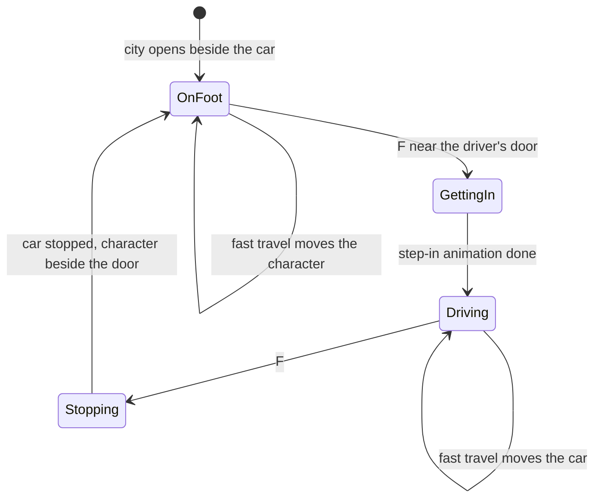
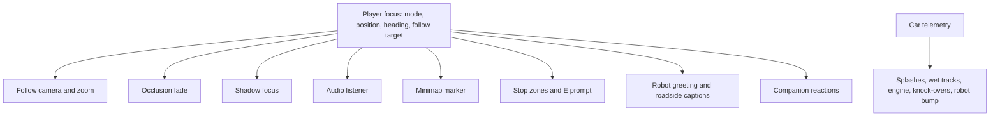

# Walking Character, Companions and Route Music - Plan

## Goal Capsule

- **Objective:** Visiting Apu's portfolio feels like stepping into a cozy little game world. A chibi Apu walks the city and hops in and out of the car, two original companions live there, and relaxed route music plays. Every character and tune is original, so the site is safe to publish under Apu's name.
- **Product authority:** Apu Islam (portfolio owner). This plan covers the character, the companions and the music together.
- **Means:** a player focus that is the character on foot or the car when driving (KTD1), a walker on Rapier's character controller (KTD2), Blender-built toon figures animated in code (KTD4), steering-driven companions with no physics bodies (KTD5), and a composed chiptune theme in the existing music bed (KTD7).
- **Open blockers:** U3 and U4 need Apu's look (a photo or short description of hair, skin tone and a signature outfit) before modeling. Every other unit can start now.
- **Stop conditions:** stop and ask if the frame-rate gate (R18) fails after U4, or if a look-dev design for the character or a companion is not approved.
- **Execution profile:** units land one at a time with their tests. Apu approves the look-dev capture before U3 and U4 integrate, and test-drives each build before code review.

---

## Product Contract

### Summary

A chibi avatar of Apu stands beside the parked car when the city opens. Visitors walk the character around on foot, or press one key to get in and drive as today, and step out again wherever the car is parked. Two original companions roam the city and react when the character comes near: a small electric critter that throws sparks and a cat-like gadget companion. An original, relaxed, chiptune-flavoured route theme replaces the current score. The city keeps its golden-hour look; only the new characters use the chunky toon style.

### Problem Frame

The city is beautiful but empty: the only things in it are the car and a robot standing in the road. It reads as a driving tech demo more than a place you visit, and the ambient score doesn't give the warm, adventurous mood of the games that inspired it. Apu wants the feel of a Pokémon route, but borrowing that franchise's characters or music in a public portfolio would invite takedowns and undercut Apu professionally.

### Key Decisions

- **One plan for the character, companions and music.** (session-settled: user-directed — chosen over brainstorming the walking character first, the companions first, or the music first: Apu wants them planned together.)
- **Only the new characters take the toon style; the city keeps its look.** Governs R6. (session-settled: user-directed — chosen over restyling the whole city toward a bright toon look, and over a toon-shading pass on the city: the golden-hour city was just finished and approved.)
- **Visitors start on foot, beside the parked car.** Governs R1. (session-settled: user-directed — chosen over starting in the car, and over starting on foot with the car parked elsewhere.)
- **The character is a chibi version of Apu.** Governs R5. (session-settled: user-directed — chosen over an anonymous trainer and over letting visitors pick a look.)
- **Both companions roam the city on their own.** Governs R11. (session-settled: user-directed — chosen over a critter that follows the character, and over a single companion.)
- **Everything is original.** No Pokémon or Doraemon characters, look-alikes, names or music. Governs R10, R15. (session-settled: user-approved — the franchises' characters and soundtrack were raised as a takedown and reputation risk, and Apu confirmed original designs in their spirit.)
- **Characters are low-poly figures built in Blender and animated in code**, the way the robot waves. They stay original, light to download, and matched to the chunky style. A downloaded rigged character would need per-download approval and would be harder to make look like Apu. Governs R5, R10, R18.

### Requirements

**Walking and driving**

- R1. When the 3D city opens, the character stands on foot beside the parked car at the start, and the visitor controls the character.
- R2. On foot, W A S D and the arrow keys walk the character in the direction pressed relative to the screen, and holding Shift makes the character run. Touch uses the existing joystick.
- R3. Pressing F near the car, or tapping a "Get in" button on touch, puts the character in the driver's seat, and the car then drives exactly as it does today. Pressing F again, or tapping "Get out", stops the car and sets the character beside it, at the driver's door when that side is clear.
- R4. On foot, buildings, walls, the pond and other solid scenery stop the character, who walks on roads, sidewalks, plazas and lawns. On foot, the visitor can open every career stop with E inside its zone, the robot greets the character, and the footballs can be kicked. Lamp posts, trees, cones, crates and the brick wall do not fall over when the character walks into them; only the car knocks them over.
- R5. The character is an original chibi avatar of Apu, with chunky proportions and toon shading, based on Apu's own look. The character idles, walks, runs, and gets in and out of the car with simple animations. Apu approves the character in a capture before it ships.
- R6. The character and companions use a chunky toon style that sits naturally in the golden-hour city. The city itself is unchanged.
- R7. The camera moves in closer on foot, so the character reads clearly, and eases back out to today's driving view once the character is in the car.
- R8. The HUD controls help, the welcome card and the touch controls explain walking, running, and getting in and out of the car.
- R9. Fast travel, the map letters and clicking a building still take the visitor to a stop. A visitor on foot arrives on foot, and the car stays where it was left.

**Companions**

- R10. Two original companions live in the city: a small yellow-and-cream electric critter, and a cat-like companion who carries gadgets. Each has its own name and a design that is not a look-alike of any existing character.
- R11. Both roam the city on their own paths and idle in places that suit them, such as the park, the pitch and the plazas.
- R12. When the character walks or drives near a companion, it reacts: the critter throws a burst of sparks with a crackle, and the cat waves and shows off a gadget. The reaction has a short cooldown so it doesn't repeat constantly.
- R13. The companions always get out of the car's way. The car never hits, knocks over or throws a companion.
- R14. Companions keep moving and reacting at night, and the critter's sparks glow in the dark.

**Music**

- R15. An original, relaxed, chiptune-flavoured route theme replaces the current background score. It is generated in the browser, adds nothing to the download, and evokes the mood of a cozy game route without copying any existing melody.
- R16. The existing Background music switch, volume and mute work with the new theme, and nothing plays before the visitor's first click, tap or key press.

**Everything else**

- R17. Driving controls, physics, career stops, knock-overs, the boost, the robot, panels, the minimap, sound effects, reduced motion and the quick view keep working as they do today.
- R18. The city still holds the frame-rate and download targets: at least 58 fps on the M1 laptop at retina size, and under the 8 MB total download.

### Acceptance Examples

- AE1. **Covers R1, R3, R7.** Given the city has just opened, the character stands beside the car with the camera close on the character. When the visitor presses F, the character gets in and the camera eases out to the driving view, and W drives off.
- AE2. **Covers R3, R9.** Given the visitor is driving, when they press F, the car stops and the character steps out beside it. When they then use the map to travel to the Projects Hall, the character arrives there on foot and the car stays where it was.
- AE3. **Covers R4.** Given the character is on foot in the Career Tower's zone, pressing E opens the Career panel. Walking into a lamp post stops the character and the lamp stays standing.
- AE4. **Covers R12, R13.** Given the critter is crossing a road, when the car drives toward it, it scampers clear and is never hit. When the character walks up to it, it throws sparks with a crackle, and walking away and back within a few seconds doesn't trigger it again.
- AE5. **Covers R16.** Given the visitor turned background music off on an earlier visit, the route theme stays off until they switch it on.

### Scope Boundaries

- No restyle of the city, its buildings or its lighting.
- No Pokémon, Doraemon or other existing characters, names, look-alikes, sound effects or music, and no fan-made remixes of their tracks.
- No character customization or choice of character.
- No catching, battles, dialogue trees, inventory or other game systems; the companions are ambient life, not mechanics.
- The companions do not follow the character or ride in the car.
- No new career content; the stops and panels stay as they are.
- No footstep sounds: considered and not built, since nothing asked for them and silence on foot harms nothing. Revisit if the test drive feels too quiet.

### Dependencies / Assumptions

- Apu provides a photo or short description of Apu's look before the character is modeled.
- The current camera is a fixed isometric-style view with zoom from 26 m to 110 m and a default of 52 m (`src/world/camera/framing.ts`), so a walking figure needs a closer zoom on foot.
- E already opens the stop whose zone the car is in (`src/App.tsx`), so getting in and out of the car needs its own key.
- The background score is already generated in the browser (`src/world/audio/musicBed.ts`) behind the Background music switch, so the new theme can replace it without new downloads.

### Outstanding Questions

**Deferred to Implementation**

- The companions' names and final designs, proposed in the look-dev capture (U3) for Apu to approve alongside the character.
- Final on-foot camera distance, walking and running speeds, and the spark effect, tuned in a test drive from the starting values in KTD2, KTD6 and U1.

How the character and companions move and collide is settled in KTD2 and KTD5.

---

## Planning Contract

Product Contract preservation: Product Contract unchanged, apart from the Outstanding Questions, whose movement and collision question is now answered by KTD2 and KTD5.

### Key Technical Decisions

- KTD1. **One player focus; the car keeps its own state.** A small module holds the player's mode (on foot or driving), position, heading and speed, and a handle to whatever the camera should follow. The camera, occlusion fade, shadow focus, audio listener, minimap marker, roadside captions, robot greeting and stop zones read it instead of the car. Car telemetry keeps meaning "the car", so splashes, wet tracks, the engine sound and knock-overs keep working unchanged. Governs R3, R7, R9, R17.
- KTD2. **The walker uses Rapier's kinematic character controller.** A capsule (about 0.35 m radius, 1.5 m tall) on a kinematic body, moved each physics step by the controller, with autostep for kerbs and snap-to-ground. It slides along walls and buildings. Starting speeds are 3.2 m/s walking and 6 m/s running. Input maps screen-relative, like the touch joystick (`src/world/drive/screenSteer.ts`). Governs R2, R4.
- KTD3. **Walker-only blockers keep the car's knock-overs intact.** Lamps, trees and the robot are sensors the car passes through. Each also gets a thin solid collider in a "walker only" collision group, which the walker's controller tests and the car ignores. The pond is kept out by a pure check against its depth map (`pondDepth` in the layout) that rejects any step onto pond water, while always allowing a step that lowers the depth, so the character can never be stranded in it. The walker's own capsule sits in a WALKER group that the car's body and wheel rays exclude, and the capsule is disabled while driving, so a parked character is never an invisible post in the car's way. Props (cones, crates, bench, bricks) block the walker but are not pushed; footballs get a kick impulse from the walker's velocity on contact. Governs R4.
- KTD4. **Characters are Blender-built toon figures animated in code.** Each figure is a few named parts (head, body, arms, legs, plus ears or tail) exported to its own small `.glb`. Code swings the limbs for idle, walk, run, the get-in step and companion reactions, as `src/world/scene/robotMotion.ts` does for the robot. At runtime their materials become three-step toon materials, and an inverted-hull outline gives the chunky look. No skinning, rigs or downloads. Governs R5, R6, R10.
- KTD5. **Companions steer; they have no physics bodies.** Each roams between seeded spots in its home areas (the park, the pitch, the plazas), walking straight lines that avoid buildings and the pond, and crossing a road now and then. A pure steering function flees sideways once the car would reach the companion within about 1.2 s (distance over closing speed, and never later than 10 m), so a boosted car at about 35 m/s gives the same warning as a slow one. If the car still closes in, a fast sideways-and-up leap clears its path. Routes between idle spots come from a small graph whose segments are checked against the static colliders and the pond, and flee and leap moves are clamped to points that pass the same check. Without bodies the car never collides with them. Governs R11, R13.
- KTD6. **Reactions are proximity triggers with a cooldown.** Within about 4 m of the player focus, the critter throws a burst of additive spark particles with a crackle, and the cat waves and pops out a gadget. The cooldown is about 8 s per companion. The sparks glow at night through the existing night-glow table. Governs R12, R14.
- KTD7. **The route theme is a composed loop in the existing music bed.** An original 32-bar melody, bass and arpeggio (about 92 BPM, major key), written out as note data and played with square, triangle and pulse voices through the existing scheduler in `src/world/audio/musicBed.ts`. Night softens the voices and slows the arpeggio. It keeps the Background music switch, volume and unlock behavior. Governs R15, R16.
- KTD8. **F gets in and out; E keeps opening stops.** F within 3 m of the driver's door gets in, and a "Press F to get in" prompt (in the E prompt's place and style) shows at that range. Pressing F while driving brakes the car firmly until it is under 0.5 m/s, then the character steps out at the first clear spot: the driver's side, then the passenger side, then behind the car, each tested against the colliders and the pond. If none is clear, the exit is refused and the car stays driven. Fast travel during getting in or stopping completes the transition at once. On touch, a "Get in" or "Get out" button appears at the same thresholds, and the Boost button doubles as Run on foot. Governs R3, R8.

### High-Level Technical Design

The player's mode:

Who follows the player focus:

### Assumptions

- Apu's look arrives before U3 starts.
- The Rapier build in the project (`@dimforge/rapier3d-compat`) exposes the kinematic character controller with autostep, snap-to-ground and group-filtered movement, as its type declarations show.

### Sequencing

U1 → U2 → U3 → U4 → U6, with U5 independent. U3 and U4 wait for Apu's look and the look-dev approval.

### Risks & Dependencies

| Risk | Mitigation |
|---|---|
| A design drifts toward an existing franchise character. | The look-dev capture states each design's distinguishing features and gets Apu's approval before integration (U3). Scope Boundaries rule out look-alikes. |
| Toon outlines and extra figures cost frame time. | Outlines on the character and companions only, at most three figures with a few parts each. Frame-rate gate after U4. |
| Many systems switch from the car to the player focus at once. | U1 ships the focus with the character as a simple placeholder capsule and runs the full browser suite before the figure work starts. |

---

## Implementation Units

### U1. Player focus, getting in and out, and on-foot camera

**Goal:** the visitor starts on foot beside the car, can get in and out with F or a touch button, and every system that followed the car now follows the player focus.

**Requirements:** R1, R3, R7, R9, R17, AE1, AE2. KTD1, KTD8.

**Dependencies:** none.

**Files:**
- `src/world/player.ts` (new)
- `src/world/player.test.ts` (new)
- `src/world/scene/Walker.tsx` (new; a placeholder capsule until U3)
- `src/world/scene/Car.tsx`
- `src/world/drive/input.ts`
- `src/world/drive/input.test.ts`
- `src/world/camera/FollowCamera.tsx`
- `src/world/camera/framing.ts`
- `src/world/camera/framing.test.ts`
- `src/world/camera/OcclusionFade.tsx`
- `src/world/lighting/Lighting.tsx`
- `src/world/audio/AudioDriver.tsx`
- `src/ui/Minimap.tsx`
- `src/world/scene/RoadsideCaptionProjector.tsx`
- `src/world/scene/Landmarks.tsx`
- `src/world/World3D.tsx`
- `src/world/testHooks.ts`
- `src/App.tsx`
- `src/ui/Hud.tsx`

**Approach:**
1. `player.ts` holds the mode state machine from the High-Level Technical Design as pure functions: can-enter (distance to the driver's door), enter, request-exit, exit-when-stopped. It also holds the shared focus state.
2. `Car.tsx` reads driving input only while driving, holds the handbrake while parked, and brakes on an exit request. Zone detection in `Car.tsx` and the E gate in `src/App.tsx` both read the player focus, and the HUD shows the "Press F to get in" prompt within range.
3. Fast travel places the car while driving, or the walker on foot (R9).
4. `framing.ts` gets its own on-foot zoom range (about 14 m to 40 m, default 20 m) while the driving range stays 26 m to 110 m. Wheel and pinch zoom work in both modes, and the camera remembers each mode's zoom separately and eases between them.
5. The consumers listed in KTD1 switch from the car to the player focus. The car keeps its telemetry, and the minimap keeps a parked-car marker whenever the player is on foot.
6. The test hooks report the mode and expose `place` for the walker too.

**Patterns to follow:** `src/world/carRef.ts` for shared handles without React state. `src/world/physics/boost.ts` for a pure state machine ticked from a component.

**Test scenarios:**
- Covers AE1. Starting state is on foot. F within 3 m of the driver's door enters, and F at 5 m does nothing.
- An exit request while driving at 10 m/s stays in Stopping until the car's speed is under 0.5 m/s, then returns on foot with the character beside the driver's door.
- With the driver's side against a wall, the character steps out on the passenger side. With the car in the pond and no dry spot beside it, the exit is refused and the car stays driven.
- Covers AE2. Fast travel on foot moves the walker and leaves the car in place, and while driving it moves the car.
- On foot, the framing distance matches the 20 m default and clamps to the on-foot range. After entering, it eases to the driving zoom, which still clamps to 26 m to 110 m.
- W moves the walker and not the car while on foot.

**Verification:** the existing browser suite passes after its start steps are updated (press F to drive), and a capture shows the camera close on the placeholder beside the car.

### U2. Walking: movement, blockers, pond edge and footballs

**Goal:** the character walks and runs around the city, stopped by everything solid, including lamps, trees, the robot and the pond's edge, and can kick footballs without toppling cones.

**Requirements:** R2, R4, AE3. KTD2, KTD3.

**Dependencies:** U1.

**Files:**
- `src/world/physics/walker.ts` (new)
- `src/world/physics/walker.test.ts` (new)
- `src/world/physics/groups.ts`
- `src/world/scene/Walker.tsx`
- `src/world/scene/KnockOvers.tsx`
- `src/world/scene/Landmarks.tsx`
- `src/world/scene/Footballs.tsx`
- `src/world/scene/Car.tsx`
- `src/world/audio/AudioEngine.ts`
- `src/world/audio/AudioEngine.test.ts`

**Approach:**
1. `walker.ts` holds the pure parts: screen-relative input to a desired step, walking and running speeds, the pond-edge check against `pondDepth`, and the kick impulse from walker velocity.
2. `Walker.tsx` drives the kinematic capsule with the character controller (autostep, snap-to-ground, group filter including the walker-only group).
3. Add WALKER and walker-only groups to `groups.ts`: the car's body and wheel rays exclude both, and the walker's controller tests the static world plus the walker-only blockers, excluding sensors. `KnockOvers.tsx` adds a thin solid collider in that group beside each standing lamp and tree sensor, removed when knocked. `Landmarks.tsx` adds one to the robot's kinematic body.
4. Footballs get a kick when the walker touches one. Cones and crates block without being pushed.
5. The engine drone fades out on foot and back in when driving.

**Patterns to follow:** `src/world/physics/water.ts` for layout-driven pond checks. `src/world/physics/groups.ts` for collision groups.

**Test scenarios:**
- Pressing up on screen walks toward the screen's top, at walking speed, and Shift reaches running speed.
- A step onto pond water is rejected, a step along the shore is allowed, and from inside the pond a step that lowers the depth is allowed.
- Neither the car's body nor its wheel rays interact with the WALKER or walker-only groups.
- The kick impulse points along the walker's motion and grows with speed.
- The walker-only group collides with the walker and not with the car.
- Covers AE3. In the browser, walking into a lamp stops the character and the lamp stays standing, and E in the Career zone opens the panel on foot.

**Verification:** a test walk around the start block meets no gaps in buildings, pond, lamps, trees or robot, and kicks a football.

### U3. The character: look-dev, model, toon look and animation

**Goal:** the placeholder becomes an approved chibi Apu that idles, walks, runs and steps into the car.

**Requirements:** R5, R6. KTD4.

**Dependencies:** U1, and Apu's look.

**Files:**
- `assets/blender/models/character.py` (new)
- `assets/blender/build_all.py`
- `public/models/character.glb` (new)
- `src/world/scene/toon.ts` (new)
- `src/world/scene/toon.test.ts` (new)
- `src/world/scene/characterMotion.ts` (new)
- `src/world/scene/characterMotion.test.ts` (new)
- `src/world/scene/Walker.tsx`
- `src/world/district/assets.test.ts`

**Approach:**
1. Build the character in Blender from Apu's look: big head, short body, chunky limbs, each a named node.
2. A look-dev capture at noon, dusk and night goes to Apu for approval before integration. U4's companion designs go in the same capture.
3. `toon.ts` turns a model's materials into three-step toon materials and adds an inverted-hull outline.
4. `characterMotion.ts` is a pure pose function (limb swing, bob and lean from speed, and a step-in pose), like `robotMotion.ts`.

**Patterns to follow:** `assets/blender/models/landmarks.py` (the robot) for named, animatable parts. `src/world/scene/robotMotion.ts` and its tests.

**Test scenarios:**
- `character.glb` has the head, body, arms and legs nodes.
- Standing still gives the idle pose with no limb swing, and walking speed gives a swing that grows with speed and alternates legs.
- Under reduced motion the bob and lean are zero, but walking still moves the legs.
- The toon conversion keeps each material's color and adds one outline mesh per part.

**Verification:** Apu approves the look-dev capture. The character reads clearly from the on-foot camera at noon and at night.

### U4. Companions: models, roaming, dodging and reactions

**Goal:** the electric critter and the gadget cat roam the city, dodge the car, and react when the player comes near.

**Requirements:** R10, R11, R12, R13, R14, AE4. KTD4, KTD5, KTD6.

**Dependencies:** U3 (toon look and the approved designs).

**Files:**
- `assets/blender/models/companions.py` (new)
- `assets/blender/build_all.py`
- `public/models/critter.glb` (new)
- `public/models/cat.glb` (new)
- `src/world/district/layout.ts` (companion home areas and idle spots)
- `src/world/district/layout.test.ts`
- `src/world/scene/companionSteer.ts` (new)
- `src/world/scene/companionSteer.test.ts` (new)
- `src/world/scene/Companions.tsx` (new)
- `src/world/lighting/Lighting.tsx`
- `src/world/audio/AudioEngine.ts`
- `src/world/audio/synth.ts`
- `src/world/events.ts`

**Approach:**
1. Model each companion from its approved design as named parts, one `.glb` each (KTD4).
2. The layout gets home areas, idle spots, and a small route graph between them, clear of buildings, the pond and the roads' centre lines.
3. `companionSteer.ts` is pure: choose the next spot, step along a straight path, flee a closing car, hop when it is too close, and handle reaction cooldowns.
4. `Companions.tsx` runs the steering each frame, poses the parts, spawns spark bursts, and emits a reaction event that the audio engine turns into a crackle or a chirp-and-pop.
5. The spark material joins the night-glow table.

**Patterns to follow:** `src/world/scene/robotReaction.ts` for a pure, time-driven state machine. `src/world/scene/NitroFlame.tsx` for additive effects.

**Test scenarios:**
- Every idle spot lies inside a home area, off the pond and away from buildings.
- Every route segment clears the static colliders and the pond.
- Covers AE4. A car closing at 10 m/s, and one at the boosted top speed of about 35 m/s, both send the companion sideways about 1.2 s before contact. Over a simulated pass at each speed the car never comes within 1 m of the companion, and every flee and leap lands clear of buildings, walls and water.
- A player within 4 m triggers a reaction once, and stepping away and back within the cooldown triggers nothing.
- A companion with no car near walks to its next spot and idles there.

**Verification:** a capture at noon and at night shows both companions in the city, with sparks glowing at night. Driving through the park never hits them.

### U5. The route theme

**Goal:** an original, relaxed chiptune route theme replaces the current score.

**Requirements:** R15, R16, AE5. KTD7.

**Dependencies:** none.

**Files:**
- `src/world/audio/routeTheme.ts` (new: the composed note data)
- `src/world/audio/routeTheme.test.ts` (new)
- `src/world/audio/musicBed.ts`
- `src/world/audio/musicBed.test.ts`

**Approach:** write the original melody, bass and arpeggio as note data. The music bed schedules them with chiptune voices, and night softens the voices and slows the arpeggio.

**Patterns to follow:** the existing scheduling in `src/world/audio/musicBed.ts`.

**Test scenarios:**
- The loop is 32 bars at about 92 BPM, and every note is in the theme's key.
- Night lowers the voice levels and the arpeggio rate.
- Covers AE5. With Background music off, the music bus targets silence, and switching it on fades the theme in.

**Verification:** Apu listens in the browser and approves the theme.

### U6. HUD, welcome, touch, browser tests and the frame-rate gate

**Goal:** the help, welcome card and touch controls teach walking and getting in, and the whole feature passes the browser suite and the frame-rate gate.

**Requirements:** R8, R17, R18. KTD8.

**Dependencies:** U1, U2, U4.

**Files:**
- `src/ui/Hud.tsx`
- `src/ui/TouchControls.tsx`
- `src/ui/BoostControls.test.tsx`
- `src/styles.css`
- `README.md`
- `e2e/smoke.spec.ts`
- `scripts/measure-fps.mjs`

**Approach:**
1. The controls help and welcome card describe walking, running, F to get in and out, and E for stops.
2. On touch, a Get in / Get out button appears when it applies, and Boost becomes Run on foot.
3. The browser suite gets an on-foot journey: walk, open a stop, get in, drive, get out, and fast travel on foot.
4. The frame-rate script starts by pressing F, and adds a short walk.

**Patterns to follow:** the existing touch buttons and their tests.

**Test scenarios:**
- On touch, the Get in button shows only within reach of the car, and Get out shows only while driving.
- On foot, the Boost button sets run, not boost.
- Covers AE1, AE2, AE3 end to end in the browser.

**Verification:** the full browser suite passes, the stressed frame-rate run averages at least 58 fps, and the download stays under 8 MB.

---

## Verification Contract

| Gate | Command | When |
|---|---|---|
| Types | `npm run typecheck` | every unit |
| Unit tests | `npm test` | every unit |
| Models | `npm run assets:build -- character companions` | U3, U4 |
| End-to-end | `npm run test:e2e` | U1, U2, U6 |
| Frame rate | `node scripts/measure-fps.mjs` (headed, M1 at retina size) | after U4 and at the end |
| Budget | `npm run build`, then `npm run budget` | at the end |
| Look-dev | a capture of the character and companions at noon, dusk and night | before U3 and U4 integrate |

---

## Definition of Done

- Every unit's test scenarios exist and pass, and every gate in the Verification Contract passes.
- Apu has approved the character and companion designs, and the route theme.
- AE1 to AE5 hold in a test drive.
- Driving, knock-overs, the boost, the robot, stops, panels and the quick view behave as before (R17).
- No abandoned experiments are left in the diff.
- Apu has test-driven the build before code review runs.

